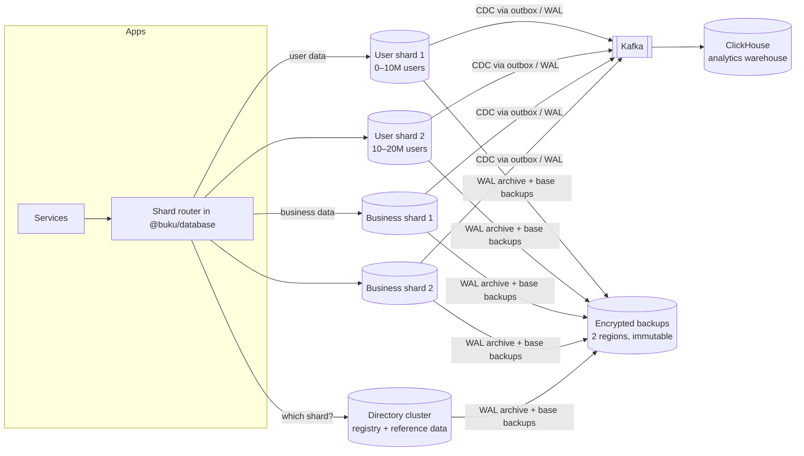
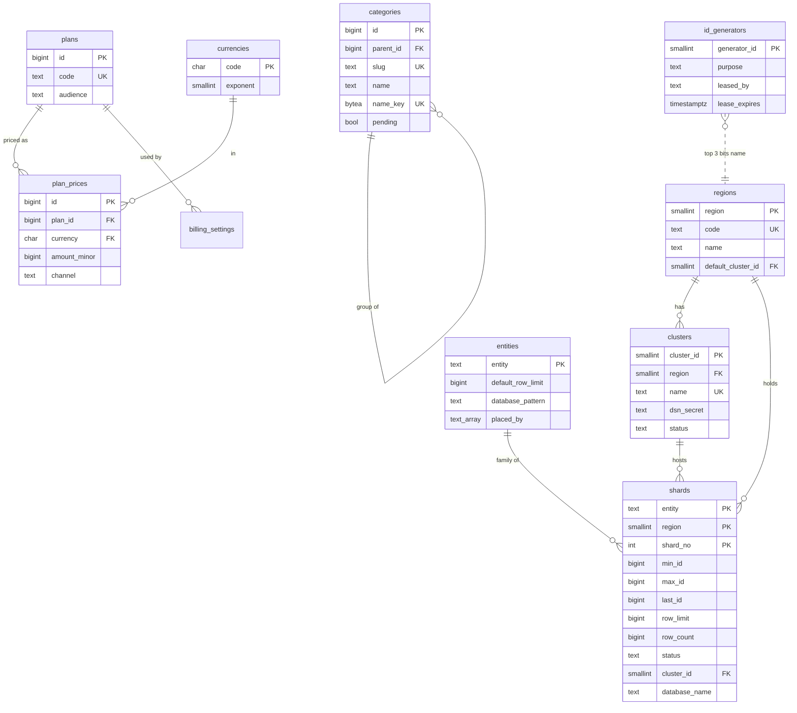
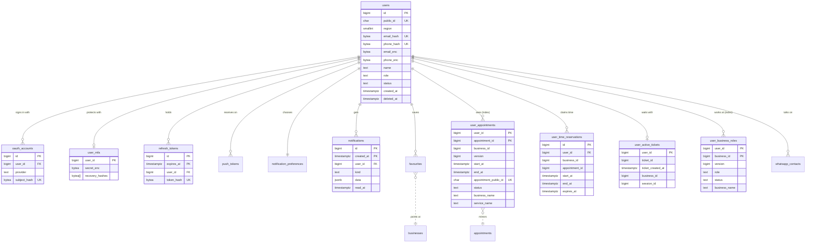
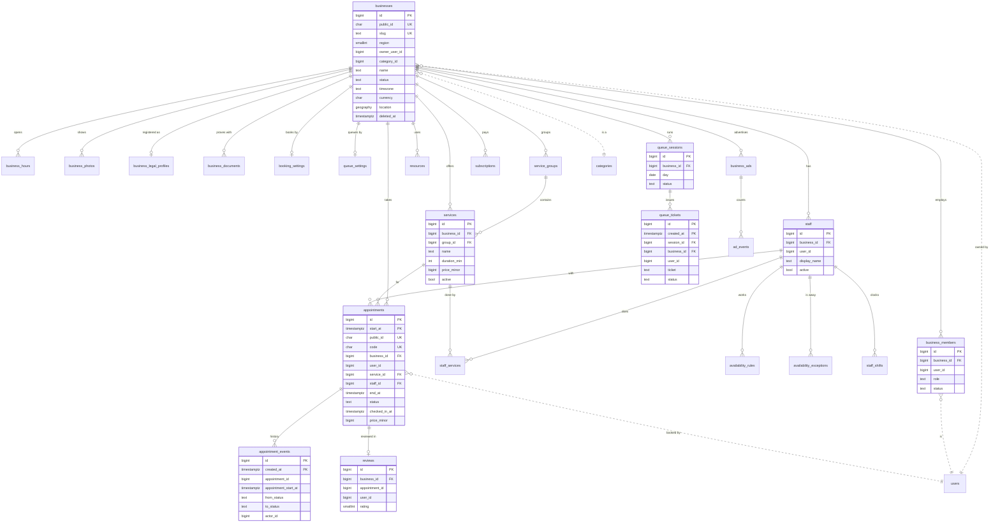
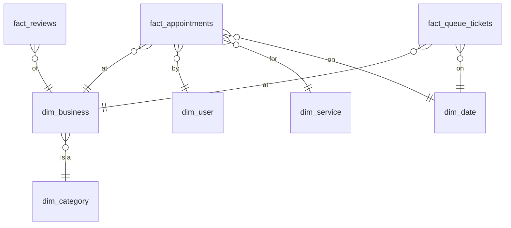

# BUKU database architecture (v2)

The database BUKU is built on from here: designed for hundreds of millions of people in many
countries, for recovery from any disaster, and for security that survives a leaked backup or a
compromised service. Every decision below has a number (DB-…) and a reason. Where this document
and the code disagree, this document is the plan and the code is the state; the build phases at
the end say what is done.

Status: **design approved by the owner's brief (2026-10-16). D1 (foundation) is built: the
directory database, the shard registry, ID generators and the router. D2a is built: global
lookups and the user shards, provisioned from the registry (§15). D2b (the business shard) is
next.** Website work pauses until D1–D3 are done (DB-000).

---

## 1. Why now (DB-000)

**Decision:** rebuild the database now, before more of the website, not after it.

**Why:**

- There is no production data. Every change below (new key types, new tables, partitioning,
  sharding) is a rebuild today and a months-long, risky data migration later.
- Every website page built on the current schema is more code to rework. The key change alone
  (DB-002) touches every service and page.
- What can wait does wait: physical shard servers, cross-region replicas and backup servers are
  deployment work (Phase 5). The schema, the shard registry, the routing code, partitioning,
  indexing and the backup set-up are designed and built now and run with one shard locally.

---

## 2. What the current database is (audit, 2026-10-16)

Measured on the development database, not guessed:

| Finding                                         | Detail                                                                                | Verdict                                                                                                                                                                  |
| ----------------------------------------------- | ------------------------------------------------------------------------------------- | ------------------------------------------------------------------------------------------------------------------------------------------------------------------------ |
| 56 tables (54 `public`, 1 `ai`, 1 `extensions`) | one database, one schema for every service                                            | needs per-domain placement (DB-004)                                                                                                                                      |
| 3 partitioned tables                            | `audit_logs`, `notifications`, `ad_events`, monthly by `created_at` (272 partitions)  | right idea, too few; nothing else that grows without end is partitioned (DB-006)                                                                                         |
| Primary keys                                    | `uuid` (UUIDv7, time-ordered) on 51 tables                                            | works, but 16 bytes in every key and index, and unreadable as ranges (DB-002)                                                                                            |
| Indexes                                         | most tables have more than the primary key (appointments 12, businesses 12, users 9)  | **23 foreign keys have no index** (e.g. `appointments.service_id`, `checked_in_by_id`, every `reviewed_by_id`): deleting a user or a service scans whole tables (DB-007) |
| Hashes                                          | blind indexes and token hashes stored as 64-character hex (`char(64)`): 64 bytes each | twice the bytes of the same value in binary, four times what a lookup needs (DB-008)                                                                                     |
| Encrypted fields                                | base64 text (≈112 bytes for an email)                                                 | ~25% larger than binary (DB-008)                                                                                                                                         |
| Money                                           | `numeric(12,2)`                                                                       | exact, but slower to sum than integers (DB-009)                                                                                                                          |
| Access                                          | a login role per service, granted only its own tables (D-092)                         | good; kept                                                                                                                                                               |
| Row-level security                              | on 1 table                                                                            | defence in depth is thin (DB-020)                                                                                                                                        |
| Encryption in transit                           | `ssl = off` (development)                                                             | production must require TLS 1.3 (DB-020)                                                                                                                                 |
| Backups                                         | `archive_mode = off`, no backup schedule                                              | **no point-in-time recovery, no disaster recovery** (DB-030…035)                                                                                                         |
| Sharding                                        | none; no registry                                                                     | needed before ~10M users (DB-010…015)                                                                                                                                    |

What is already right and stays: field-level encryption of personal data with blind indexes
(D-083), least-privilege service roles (D-092), an outbox for events, append-only audit logs,
exclusion constraints that make double bookings impossible (D-036), soft deletes.

---

## 3. Targets the design is built for

|                             | Target                                                                                             |
| --------------------------- | -------------------------------------------------------------------------------------------------- |
| People                      | 100M+ customers, 10M+ businesses, in many countries                                                |
| Bookings                    | ~2 billion appointments a year at full scale; queue tickets similar                                |
| Reads                       | p99 < 20 ms for a single-entity read; p99 < 100 ms for a business's day                            |
| Writes                      | 50k bookings/s at peak across the fleet (scales by adding shards)                                  |
| RPO (data that may be lost) | 0 for a server failure; ≤ 1 minute for a whole-region disaster                                     |
| RTO (time to recover)       | ≤ 1 minute automatic failover in a region; ≤ 1 hour to another region                              |
| Backups                     | point-in-time recovery for 35 days; monthly copies for 1 year; immutable copies in a second region |
| Residency                   | a person's or business's data can be kept in its region (e.g. EU)                                  |

---

## 4. Topology



- **Directory cluster** (one per deployment, highly available): the shard registry, ID generator
  leases, and small reference tables every shard needs (categories, plans, settings).
- **User shards**: everything that belongs to one person.
- **Business shards**: everything that belongs to one business, including its appointments and
  queues.
- **Logical vs physical shards (DB-011):** a shard is a logical unit (a numbered database). Many
  logical shards can live on one physical cluster at first and be moved to their own cluster later
  without changing any ID. Locally and at launch: every logical shard on one cluster.
- Each physical cluster: 1 primary + 1 synchronous standby (another zone) + 1 asynchronous replica
  (another region), managed by Patroni, behind PgBouncer (DB-031).

---

## 5. Identifiers

### DB-001 · Every row has a 64-bit internal ID and, where it is ever shown, a public ID

**Decision:** primary keys are `bigint` (8 bytes). Anything that appears in a URL, an API response
or a receipt also has a `public_id`: 12 characters of Base62 from a cryptographic random source
(71 bits).

**Why:** `bigint` keys halve the size of every primary key, foreign key and index compared with
`uuid` (16 bytes): at 2 billion appointments with five keys each that is ~80 GB less, before
indexes, and smaller indexes stay in memory. Internal IDs are never shown, because ordered IDs can
be counted and guessed ("business 1,000,451 exists, so does 1,000,452"), which leaks business
volume and invites enumeration attacks. Public IDs are random, so they leak nothing.

### DB-002 · Internal IDs are time-ordered "snowflake" IDs, made without a central counter

**Decision:** a 64-bit ID made of three parts:

```
 0 | 41 bits: milliseconds since 2026-01-01T00:00:00Z | 10 bits: generator | 12 bits: sequence
     (good until 2095)                                 (1,024 generators)   (4,096 IDs per ms each)
```

- **Generators** are leased from the directory (`registry.id_generators`, DB-013) by each running
  service instance, so two instances never share one. A lease lasts 60 seconds and is renewed every
  20; one that isn't renewed expires, and an expired generator is handed out again only 30 seconds
  later. The instance itself stops making IDs 5 seconds before its lease could run out, by its own
  monotonic clock, even if it can't reach the directory to hear so (`LeasedIdGenerator`). So an
  instance that freezes and wakes up late can never make the same IDs as its successor.
- The **top 3 generator bits name the region** (8 regions), so an ID says where it was made
  without a lookup: `(id >> 19) & 7`.
- Of each region's 128 generators, 120 are for service instances and the last 8 for **databases'
  own inserts**: `ids.buku_id()` makes IDs inside a database (migrations, seeds, back-fills) from
  the generator set on it (`ALTER DATABASE … SET buku.generator_id`).
- When more than 4,096 IDs are asked for in one millisecond, or the clock steps backwards, a
  generator moves its own clock on instead of waiting or repeating, so IDs stay unique and in order.
- IDs travel between services and to the website as **decimal strings** (JSON numbers lose
  precision past 2⁵³), and anything that isn't a positive 64-bit decimal is refused before it
  reaches a query (`idFromString`). The code is `@buku/common` (`IdGenerator`, `parseId`,
  `publicId`) and the directory migration (`ids.next_id`), with the same layout and epoch, tested
  against each other.

**Why:** time-ordered IDs keep inserts at the end of every index (no random page splits, unlike
UUIDv4), sort by creation time for free, and let partitions be pruned by ID range. No central
sequence means no single point of failure and no round trip per insert. 4M IDs per second per
generator is far beyond need.

**Not chosen:** keeping UUIDv7 (twice the size, awkward ranges); a central sequence per table
(a single point of failure, and block allocation adds complexity for nothing the snowflake doesn't
already give).

---

## 6. Sharding

### DB-010 · Shard by owner: people on user shards, businesses on business shards

**Decision:** two shard families.

- **User shards** hold what belongs to one person: account, sign-in, tokens, devices,
  preferences, notifications, favourites, and _their view_ of their bookings and queue tickets.
- **Business shards** hold what belongs to one business: profile, team, services, staff,
  schedules, **appointments**, queues, reviews, billing, ads.

Every child row lives on its parent's shard (**co-location**), so every everyday query and join is
on one shard: a business's day, a person's bookings, a service's staff.

**Why:** the busiest queries are "this business's day" and "this person's things". Appointments go
with the business because availability, double-booking checks and the front desk all read a
business's appointments together, under one lock.

### DB-011 · Range shards of 10 million, a limit that can be changed at any time

**Decision:** each shard family has a registry (DB-013). A shard covers one range of internal
IDs: `min_id` from its first row, `max_id` set when it fills. A shard accepts new rows until its
`row_limit` is reached, then closes and the next one opens.

- Shards are made ahead of need as **`ready`** (their database created and waiting), so opening
  the next one is a row update in the same transaction as the row that filled the last, never a
  wait for provisioning. Operators keep two or more ready per family and region.
- A shard closes at the **highest ID it has taken** (`last_id`), not at the ID that happened to
  fill it: IDs from many instances arrive slightly out of order, and closing at a late, lower one
  would put rows already placed inside the next shard's range. An ID made just before the switch
  that arrives just after it still goes to the shard whose range holds it, and is counted there.
- If a shard fills and **no shard is ready**, nobody is turned away: the open shard keeps taking
  rows past its limit, and one alert is raised (`registry.alerts`). The first placement after a
  ready shard is added closes it and resolves the alert.

- Default limits: **users 10,000,000 per shard** (the owner's brief); **businesses 1,000,000 per
  shard**, because one business brings far more rows than one person (appointments, tickets,
  reviews).
- The limit is a column, changed with one `UPDATE` (audited). Lowering it below the current count
  closes the shard at the next new row; raising it lets a shard keep filling.
- Because IDs only grow, the ranges never overlap: finding a row's shard is "the shard whose range
  contains this ID", in the same region (the region is read from the ID, DB-002).

**Why:** this is the owner's design, and it gives shards a fixed, known size, so capacity
planning, backup time and restore time per shard are predictable.

**The trade-off, handled:** all new people sign up on the newest user shard, so it gets the most
new activity. That's why shards are _logical_ (DB-012): the newest shard starts on the strongest
cluster, older and quieter shards move to cheaper clusters, and moving a shard never changes an
ID.

### DB-012 · Logical shards on physical clusters

**Decision:** `registry.clusters` lists physical clusters (region, the name of the setting that
holds its address, status); each shard row points at one. The address is host, port and TLS
options only: every role signs in with its own credentials, so the registry never holds a
password and one address serves every service. Moving a shard means copying it to another cluster
(logical replication), then switching the pointer in one transaction while writes for that shard
pause for seconds.

**Making shards real** (`scripts/provision-shards.ts`, `pnpm db:shards`; the `db-shards`
container): for every shard in the registry that isn't retired, ready ones included, it creates
the database on its cluster from `template1` (so it starts with every extension, `pg_partman`
included), takes away the template's default grants (DB-023), applies its family's migrations as
the schema owner, records which shard it is (`buku.shard = 'user:0:1'`), and schedules its hourly
partition upkeep in `pg_cron`. It is idempotent: run it after adding shards and after every
release. Each shard keeps its own migration history, so one that missed a release is brought up
to date on the next run.

**Why:** shards can be rebalanced and tiered without downtime or any change to IDs or code.

### DB-013 · The registry

Its own database, `buku_directory` (the directory cluster in production), schemas `registry` and
`ids`. The full definition, with every constraint, is
`packages/database/prisma/directory/migrations/20261016120000_registry/migration.sql`; in short:

| Table                    | One row per                         | What it holds                                                                                                                                                                                 |
| ------------------------ | ----------------------------------- | --------------------------------------------------------------------------------------------------------------------------------------------------------------------------------------------- |
| `registry.regions`       | region (0..7, the code inside IDs)  | `code` ('pk'), name, active, the default cluster for new shards                                                                                                                               |
| `registry.entities`      | shard family ('user', 'business')   | the default `row_limit` for new shards, the database name pattern (`buku_{entity}_{region}_{shard}`), `placed_by`: the database roles allowed to place its rows                               |
| `registry.clusters`      | physical cluster                    | region, name, `dsn_secret` (the **name** of the secret holding its connection string: a check refuses anything that looks like a connection string), status (active, draining, retired)       |
| `registry.shards`        | logical shard                       | family, region, number; `min_id`, `max_id`, `last_id`; `row_limit`, `row_count`; status (ready, open, full, read_only, moving, retired); cluster; database name; when created, opened, closed |
| `registry.id_generators` | generator (1,024)                   | purpose (service, database), who holds the lease, until when                                                                                                                                  |
| `registry.changes`       | change to any table above           | when, which database role, who asked (`buku.actor`), the row before and after                                                                                                                 |
| `registry.version`       | (one row)                           | a number that goes up with every change; routers re-read when it moves                                                                                                                        |
| `registry.alerts`        | open problem                        | a shard that filled with none ready to take over                                                                                                                                              |
| `ids.state`              | generator used inside this database | the last millisecond and sequence                                                                                                                                                             |

The database guarantees the rules, whatever a caller sends: one open shard per family and region
(a unique index); ranges that never overlap (an exclusion constraint); a `ready` shard has no
range, an open one has no end, a full one has one; `last_id` inside the range; names, codes,
patterns and role lists in strict formats (no spaces, quotes, markup or emoji can get in).

**Placing a new person or business** is `registry.place(family, id)`, one short transaction on
the directory: it checks the caller's role is in the family's `placed_by`, locks the shard whose
range holds the ID (opening the first ready one if the family has none open yet), counts the row,
moves `last_id`, and closes and hands over at the limit (DB-011). If the shard it waited for filled
meanwhile, it looks again and finds the next one. 400 placements at once, arriving in random order,
are counted exactly, every row on the shard whose range holds it (tested).

**Finding an existing row's shard** costs no round trip almost always. Every service keeps a copy
of the registry (`ShardRouter`, a few hundred rows) and trusts it only where it can't be out of
date: a closed range never changes, and in the open shard every ID up to `last_id` stays there for
good. Only an ID newer than that might belong to a shard that opened a moment ago; for those the
router first checks the registry (one tiny query, shared by every lookup waiting at that moment).
It also re-reads by itself every 5 seconds when the version has moved.

**Who may do what:** services read the registry and call its functions, and never write its
tables (`DIRECTORY_ACCESS` in `packages/database/src/access.ts`, applied by
`scripts/apply-access.ts`). Leasing, placing and routing are functions; changing the layout is for
operators (the owner role, through reviewed tooling), and every change lands in
`registry.changes`.

### DB-014 · Rules that cross shards

- **No database foreign keys across shards** (they can't exist). A business's owner is a person on
  a user shard: the business row keeps `owner_user_id` as a plain `bigint`, checked by the service
  when written, and kept consistent by events (e.g. a deleted person's businesses are handled by the
  `users.deleted` consumer, as today).
- **One appointment at a time per person, across all businesses (D-036)** stays a database
  guarantee: the booking first claims the time on the person's shard in
  `user_time_reservations` (an exclusion constraint on `(user_id, time range)`), then writes the
  appointment on the business shard; if the second step fails, the claim is released. A sweeper
  removes claims with no appointment after 2 minutes.
- **One queue at a time per person** works the same way (`user_active_tickets`, one row per person).
- **"My bookings" and "my businesses"** are read from small index tables on the person's shard
  (`user_appointments`, `user_business_roles`), kept up to date from the business shards' outbox
  events. They hold only what a list needs (IDs, times, names), so the person's pages are one-shard
  reads.

### DB-015 · Reference data is global and copied, not sharded

Categories, plans and prices, billing and notification settings, cities: a few thousand rows
that every shard reads. They live on the directory and are copied to every shard (read-only there)
by logical replication, so joins with them stay local.

### DB-017 · Built to be changed: what will change is a row, not code

**Decision:** everything about the layout that will change as BUKU grows is data in the registry,
checked by constraints and logged: regions, clusters, shard families, shards, limits, and who may
place what. Statuses are `text` with `CHECK` constraints rather than enum types, so adding one is a
one-line constraint change, not a type migration. Routers re-read the registry when its version
moves, so no change needs a deploy or a restart.

| To…                                | Do this (as an operator, with `SET buku.actor = '<who and why>'` so the log says)                                                                   |
| ---------------------------------- | --------------------------------------------------------------------------------------------------------------------------------------------------- |
| change a shard's limit             | `UPDATE registry.shards SET row_limit = … WHERE entity = … AND region = … AND shard_no = …` (lower than its count: it closes at its next row)       |
| change the limit for new shards    | `UPDATE registry.entities SET default_row_limit = … WHERE entity = …`                                                                               |
| add capacity                       | `SELECT * FROM registry.add_shard('user', 0)` (a `ready` shard, numbered next, named by the pattern; D2's provisioning creates its database)        |
| add a region                       | insert into `registry.regions` (a free code 0..7) and a cluster for it; set its default cluster; add ready shards. Its 128 generators already exist |
| add a cluster, or move new shards  | insert into `registry.clusters`; point the region's `default_cluster_id` at it                                                                      |
| add a shard family                 | insert into `registry.entities` (name, limit, database pattern, `placed_by`); add ready shards; the router needs no change                          |
| let another service place a family | `UPDATE registry.entities SET placed_by = …`                                                                                                        |
| move a shard to another cluster    | copy it (logical replication), set `status = 'moving'` for the switch-over seconds, then `cluster_id = …` and back to `full`/`open` (DB-012)        |
| add a status, an alert kind        | change the `CHECK` constraint in a migration                                                                                                        |

**What is fixed for good:** the ID layout and its epoch (DB-002). Every ID already made depends on
them; changing either would break their order and their region bits. Everything else can change.

**Why:** the owner's brief: the database must keep up with features added over the years. A
registry that is data, with its rules in constraints and a log of every change, can be adjusted
safely by an operator in minutes, and a mistake is visible in the log and refused by the
constraints rather than discovered later in production data.

### DB-018 · Global lookups: what a person or business is found by, unique across every shard

**The problem:** signing in starts from an email, a phone number or a Google or Apple account; a
business page starts from its address (`/b/<slug>`) or public ID; a WhatsApp message arrives from
a number. None of these says which shard to look on, and a unique index on one shard can't stop
the same email being registered on another.

**Decision:** one table of **handles** on the directory, `lookup.handles` (kind, key → owner ID),
with its kinds in `lookup.handle_kinds`. The primary key `(kind, key)` makes every handle unique
across all shards. Finding someone is two steps with no search: the handle gives the ID, and the
ID gives the shard (DB-011).

| Kind                        | Key                                                                 |
| --------------------------- | ------------------------------------------------------------------- |
| `user.email`, `user.phone`  | the 16-byte keyed blind index (DB-008), never the address or number |
| `user.google`, `user.apple` | the blind index of the account's subject                            |
| `user.public_id`            | the 12 characters                                                   |
| `user.employee_login`       | the business's ID (8 bytes) + the username (D-034)                  |
| `user.whatsapp`             | the blind index of the linked number                                |
| `user.push_token`           | the blind index of the device's token (a device is one person's)    |
| `business.public_id`        | the 12 characters                                                   |
| `business.slug`             | the slug                                                            |

- **Written only through functions:** `lookup.claim` (taking a handle someone else has is
  refused and says by whom; only kinds that move between people by design, like a device's push
  token, can be taken over), `lookup.release` (only by its owner), `lookup.release_all` (an
  erased account), `lookup.find`. Each checks that the caller's role is one of the kind's
  `writers` (the auth service for emails, the notification service for WhatsApp numbers, the
  business service for slugs) and that the key is the kind's size.
- **Split into 16 parts by a hash of the key** from the start (two or three handles per person
  is hundreds of millions of rows), so it never has to be rebuilt to be split.
- A new kind is a row (DB-017), logged like any other change to the layout.
- Child rows (an appointment's public ID, a queue ticket) don't need handles: they are always
  reached through their parent (the person's `user_appointments`, or the business whose page it
  is), whose shard is already known.

**Why not a hash of the email to pick the shard?** It would tie every person to a shard by their
email (changing it would mean moving them) and would still need a table for Google accounts,
phones and slugs. One small, partitioned table does all of it.

---

## 7. Partitioning and retention

### DB-006 · Partition what grows without end, by time; leave the rest alone

**Decision:** declarative range partitions, created ahead and dropped behind by `pg_partman`,
scheduled by `pg_cron`:

| Table (shard)                                | Partitioned by | Partition size | Kept online           | Then                                            |
| -------------------------------------------- | -------------- | -------------- | --------------------- | ----------------------------------------------- |
| `appointments` (business)                    | `start_at`     | month          | 25 months             | detached to cheap storage, still restorable     |
| `appointment_events` (business)              | `created_at`   | month          | 25 months             | same                                            |
| `queue_tickets` (business)                   | `created_at`   | month          | 13 months             | same                                            |
| `staff_shifts` (business)                    | `started_at`   | month          | 25 months             | same                                            |
| `notifications` (user)                       | `created_at`   | month          | 6 months              | dropped (they're also in email/push)            |
| `refresh_tokens` (user)                      | `expires_at`   | month          | until expiry + 7 days | dropped                                         |
| `outbox_events` (every shard)                | `created_at`   | day            | 7 days after sent     | dropped                                         |
| `processed_events` (every consumer)          | `occurred_at`  | day            | 14 days               | dropped                                         |
| `audit_logs` (every shard)                   | `created_at`   | month          | 25 months online      | copied to immutable storage first, kept 7 years |
| `ad_events`, `webhook_deliveries` (business) | `created_at`   | month / week   | 13 months / 30 days   | dropped                                         |

**Why:** these are the tables that reach billions of rows. Monthly partitions keep each one's
indexes small, let queries on "this month" touch one partition, and turn deleting old data into
dropping a partition (instant, no bloat, no vacuum storm). Small tables (settings, services, staff)
gain nothing from partitions and pay overhead, so they stay plain.

**Keys on partitioned tables:** PostgreSQL requires the partition key in a partitioned table's
primary key, so `appointments` has `PRIMARY KEY (id, start_at)` and rows that point at an
appointment carry both (`appointment_id`, `appointment_start_at`). The snowflake ID alone stays
unique (DB-002).

**Made by `pg_partman`, run hourly by `pg_cron`** in every shard database, as the tables' owner:
partitions exist ahead (3 months for monthly tables, a week for daily ones, and 25 months for
refresh tokens, whose sessions can slide for up to two years) and expired ones are dropped by
each table's retention. `infinite_time_partitions` keeps them coming through a quiet spell. A
`_default` partition catches anything outside the range, and a row there is a monitoring alert
(D4).

### DB-019 · Ledgers that must catch duplicates are partitioned by the event's own time

**Decision:** `processed_events` (a consumer's "already done" list) is partitioned by the
event's `occurred_at` from its envelope, not by when it was processed, with the key
`(consumer, event_id, occurred_at)`.

**Why:** a unique key on a partitioned table only holds within a partition. Partitioned by
processing time, an event delivered at 23:59 and again at 00:01 would land in two partitions and
be processed twice. An event's own time never changes, so every redelivery lands in the same
partition and the key catches it, while old days are still dropped whole.

`notification_marks` (each scheduled message sent once) is not partitioned: its keys repeat over
months, so it is one table keyed `(user_id, key)` and a sweeper removes marks older than 13
months, in small batches, through a BRIN index on `created_at`.

---

## 8. Indexes and storage

### DB-007 · Index rules

1. **Every foreign key has an index** that starts with its columns (fixes the 23 gaps found).
2. Every index on a sharded table **starts with the owner key** (`business_id`, `user_id`) when
   queries filter by owner, so a business's or person's rows are next to each other.
3. **Partial indexes** for the rows that matter: `WHERE deleted_at IS NULL`, `WHERE status IN
('pending','confirmed')`.
4. **Covering indexes** (`INCLUDE`) for the lists that run all day (a business's day, a person's
   upcoming visits), so they never touch the table.
5. **BRIN indexes** on time columns of the biggest append-only tables (audit, events): a few
   kilobytes instead of gigabytes.
6. **No unused or duplicate indexes:** `pg_stat_statements` and `pg_stat_user_indexes` are reviewed
   every release; an index nothing uses is removed.
7. Every index added in a migration is created `CONCURRENTLY` on large tables.

### DB-008 · Hashes and encrypted values are stored as bytes, at the size they need

| Value                                             | Now                             | v2                                                         | Why                                                                                                                                                    |
| ------------------------------------------------- | ------------------------------- | ---------------------------------------------------------- | ------------------------------------------------------------------------------------------------------------------------------------------------------ |
| Blind indexes (email, phone, registration number) | 64 hex chars                    | `bytea`, **16 bytes** (HMAC-SHA-256 truncated to 128 bits) | 128 bits is collision-free at any number of people we'll ever have (a collision needs ~2⁶⁴ values) and still keyed (the key never leaves the services) |
| Token hashes (refresh, reset)                     | 64 hex chars                    | `bytea`, 32 bytes (SHA-256)                                | tokens are random 256-bit values; the full hash keeps them unguessable                                                                                 |
| Encrypted fields (email, phone, secrets)          | base64 text                     | `bytea`                                                    | ~25% smaller, no encoding step                                                                                                                         |
| Password hashes                                   | Argon2id PHC string (≈97 chars) | unchanged                                                  | the standard self-describing format; parameters can change per user. Its size is fixed and small next to everything else                               |
| IP addresses (ads, security)                      | hex hash                        | `bytea` 16 bytes, keyed                                    | same as blind indexes                                                                                                                                  |

At 100M people this alone saves ~30 GB of table and index space on user shards.

### DB-009 · Money in integer minor units

**Decision:** amounts are `bigint` in the currency's minor unit (paisa, cents), with the
currency's exponent from a reference table.

**Why:** exact like `numeric`, but 8 bytes, and sums and comparisons are integer operations (much
faster in reports). The payment industry stores money this way.

### DB-016 · Rows laid out to waste nothing

Columns are ordered by size in every `CREATE TABLE` (8-byte, then 4-byte, 2-byte, 1-byte, then
variable length), so PostgreSQL's alignment adds no padding. On a row with mixed types this saves
10–30% of the row header and padding.

---

## 9. Diagrams (entity–relationship)

Solid lines are foreign keys inside a shard. Dotted lines (`..`) are references across shards,
kept by the services and events (DB-014). Keys: `id` is the internal `bigint`; `public_id` is shown
only where it exists.

### 9.1 Directory and reference data



### 9.2 A person (user shard)



### 9.3 A business (business shard)



### 9.4 Analytics warehouse (ClickHouse, star schema)



Facts carry the same internal IDs as the shards, so every join that is impossible across shards
(e.g. "bookings per category per city per month") is a plain join here (DB-040).

---

## 10. Table catalogue

Where every current table goes. "→" is its v2 name when it changes.

| Current table                                                                                                                                                                         | Home                         | Partitioned            | Notes                                              |
| ------------------------------------------------------------------------------------------------------------------------------------------------------------------------------------- | ---------------------------- | ---------------------- | -------------------------------------------------- |
| users                                                                                                                                                                                 | user shard                   | no (sharded)           | bigint id + public_id; bytea blind indexes; region |
| oauth_accounts, user_mfa, push_tokens, notification_preferences, notification_marks, whatsapp_contacts, favourites                                                                    | user shard                   | no                     | co-located by `user_id`                            |
| refresh_tokens                                                                                                                                                                        | user shard                   | weekly by `expires_at` | dropped after expiry                               |
| notifications                                                                                                                                                                         | user shard                   | monthly                | 6 months                                           |
| — (new) user_appointments, user_time_reservations, user_active_tickets, user_business_roles                                                                                           | user shard                   | no                     | DB-014                                             |
| businesses, business_members, business_hours, business_photos, business_documents, business_legal_profiles, business_reports, business_search_stats, booking_settings, queue_settings | business shard               | no                     | co-located by `business_id`                        |
| services, service_categories → service_groups, staff, staff_services, staff_photos, resources, availability_rules, availability_exceptions                                            | business shard               | no                     |                                                    |
| staff_attendance → staff_shifts                                                                                                                                                       | business shard               | monthly                |                                                    |
| appointments                                                                                                                                                                          | business shard               | monthly by `start_at`  | PK `(id, start_at)`                                |
| appointment_status_history → appointment_events                                                                                                                                       | business shard               | monthly                |                                                    |
| queue_sessions                                                                                                                                                                        | business shard               | no                     |                                                    |
| queue_entries → queue_tickets                                                                                                                                                         | business shard               | monthly                |                                                    |
| reviews, payments, subscriptions, plan_requests                                                                                                                                       | business shard               | no                     | user subscriptions stay dormant (D-101)            |
| business_ads, webhooks                                                                                                                                                                | business shard               | no                     |                                                    |
| ad_events, webhook_deliveries                                                                                                                                                         | business shard               | monthly / weekly       |                                                    |
| ai_receptionist_configs, ai_call_logs, ai.business_knowledge_chunks                                                                                                                   | business shard               | ai_call_logs monthly   |                                                    |
| audit_logs                                                                                                                                                                            | every shard                  | monthly                | + immutable archive (DB-022)                       |
| outbox_events, processed_events                                                                                                                                                       | every shard / consumer       | daily                  |                                                    |
| categories, plans, plan_prices, billing_settings, billing_channel_fees, billing_cost_items, notification_settings                                                                     | directory (copied to shards) | no                     | DB-015                                             |
| — (new) registry.*, currencies                                                                                                                                                        | directory                    | no                     | DB-013, DB-009                                     |

---

## 11. Security

### DB-020 · Defence in depth, layer by layer

1. **Network:** databases only on private networks; no public address; firewall allows only the
   service hosts and the bastion.
2. **Transport:** `hostssl` only, TLS 1.3 minimum, server certificate verified by every client
   (`sslmode=verify-full`).
3. **Authentication:** SCRAM-SHA-256; one login role per service (kept from D-092), each granted only
   its own tables and only the verbs it uses; no service uses a superuser or owns tables; the
   migrator role is used only by migrations.
4. **Row-level security** on business-shard tables as a second wall: each transaction sets
   `buku.business_id` and policies allow only that business's rows, so a bug that forgets a
   `WHERE business_id = …` returns nothing instead of another business's data.
5. **Field encryption** of personal data (AES-256-GCM, keys versioned and rotatable, D-083) and
   keyed blind indexes (DB-008): a stolen backup or disk shows no emails or phone numbers.
6. **Keys** live in a key manager (KMS), never in the database or its backups; services get them at
   start.
7. **Timeouts per role** (`statement_timeout`, `idle_in_transaction_session_timeout`, `lock_timeout`)
   so one bad query can't hold a shard.
8. **Encryption at rest** of every disk and every backup (DB-033).

### DB-021 · People who touch the database

- No standing human access to production. Access is **break-glass**: time-limited (1 hour),
  requires two-step sign-in and a reason, read-only by default, and every statement is logged.
- Development and test data is always synthetic (the seed). Production data is never copied to
  any other environment.

### DB-022 · Audit that can't be rewritten

- `pgaudit` logs every DDL, role and permission change, and every human session.
- Application audit rows (`audit_logs`) are append-only for every role (no `UPDATE`/`DELETE`
  grant), and each month's partition is copied to object storage with **object lock** (WORM) before
  it leaves the database: kept 7 years.

### DB-023 · Shard databases grant nothing by default

**Decision:** when a shard database is made, the default privileges it inherits from `template1`
are taken away, so a table or partition the migrator creates is usable by nobody until a
migration or `apply-access` grants it. Grants are on the parent tables only, never a partition.

**Why:** with defaults on, every new table, and every partition `pg_partman` makes each hour, would
quietly be readable and writable by the app role, including the audit log's (v1 had to revoke
those one by one). With nothing by default, a forgotten grant is a loud "permission denied" in a
test, never a silent hole; and since partitions are reached only through their parent, a service
can't read or empty one directly.

---

## 12. Backups and disaster recovery

### DB-030 · Continuous archiving and point-in-time recovery

**Decision:** `pgBackRest` on every cluster: WAL archived continuously (`archive_timeout = 60s`),
a full backup weekly, differential daily, incremental every 6 hours. Point-in-time recovery to any
second in the last **35 days**.

**Why:** a full backup alone loses up to a day; with WAL, at most the last minute (and nothing for a
single-server failure, DB-031).

### DB-031 · High availability in a region

Each cluster: primary + **synchronous** standby in another zone (no committed write is ever lost if
the primary dies) + Patroni with a consensus store (etcd) for automatic failover in under a minute.
PgBouncer in front, so services reconnect without noticing.

### DB-032 · Another region

An asynchronous standby of every cluster in a second region (a few seconds behind), plus the
backups (DB-033). Region failover is a documented, rehearsed runbook (promote, switch the registry's
cluster pointers, switch DNS): **≤ 1 hour**.

### DB-033 · Where backups live

Two object stores in two regions, both encrypted (AES-256, keys in KMS), the second with object lock
(backups can't be deleted or altered for 35 days, even by an administrator: protection against
ransomware and mistakes). Monthly full backups kept 12 months.

### DB-034 · Restores are tested, not assumed

- **Every day:** `pgbackrest verify` checks every backup and WAL file.
- **Every week (automatic):** the latest backup of one shard, picked in turn, is restored to a
  scratch server, brought to a point in time, and checked: row counts against the source, sample
  checksums, and the service smoke tests. The result is a metric; a failure pages someone.
- **Every quarter:** a full region-failover exercise.

### DB-035 · Logical safety nets

Mistakes that replicate instantly (a wrong `DELETE`) are recovered by point-in-time restore of the
affected shard to a side server and copying back the rows. Soft deletes (`deleted_at`) and the
audit log make most mistakes reversible without a restore.

---

## 13. Analytics and joins

### DB-040 · Analytics run on a warehouse, never on the shards

**Decision:** every shard's changes stream to ClickHouse (outbox events today; WAL change data
capture with Debezium at scale) into the star schema of §9.4. Dashboards, reports, the profit
calculator and any cross-business question read the warehouse.

**Why:** questions across all businesses or all people need joins across shards, which a sharded
OLTP database can't do quickly, and heavy reports must never slow down booking. The warehouse is
built for scans and aggregates over billions of rows.

**Joins on the shards** are kept fast by co-location (DB-010): every join a page needs is inside
one shard, on indexed keys.

---

## 14. Operations

- **Extensions:** `pg_stat_statements` (query costs), `pgaudit`, `pg_partman`, `pg_cron`,
  `btree_gist` (exclusion constraints), `pg_trgm` (search), `postgis` (places), `vector` (AI); all
  in the BUKU Postgres image.
- **Connection pooling:** PgBouncer in transaction mode per cluster; Prisma connects through it.
- **Monitoring:** replication lag, WAL archive lag, backup age, bloat, slow queries, connection
  saturation, partition coverage (a missing future partition is an alert).
- **Migrations:** expand → migrate → contract; every shard migrated by the same migration, tracked
  per shard; large indexes `CONCURRENTLY`.
- **Databases and admin-only extensions** (the directory, `pg_cron`, `pgaudit`,
  `pg_stat_statements`, also in `template1` so every new shard database has them) are created by
  `scripts/prepare-databases.ts`, idempotent, before migrations: `pnpm db:prepare`, the `db-prepare`
  container, and CI.

---

## 15. Build phases

| Phase                 | What                                                                                                                                                                                                                                                     | Done when                                                                                                                                                 |
| --------------------- | -------------------------------------------------------------------------------------------------------------------------------------------------------------------------------------------------------------------------------------------------------- | --------------------------------------------------------------------------------------------------------------------------------------------------------- |
| **D1 Foundation** ✅  | Postgres image with the extensions; directory schema (registry, generators, settings, currencies); the ID generator (`@buku/ids`: TypeScript and `buku_id()` in SQL) and public IDs; the shard router in `@buku/database` (one shard per family locally) | unit and integration tests for IDs (uniqueness under concurrency, ordering, region bits), allocation (limit reached → next shard, limit changed), routing |
| **D2 Schema v2** 🚧   | the new baseline: every table rebuilt per §5–§10 (bigint keys, public IDs, bytea hashes, money in minor units, partitions, every index, constraints, the new user-side tables), RLS policies, grants per service; a new seed. In five slices, below      | migrations apply on an empty database; the seed loads; constraint tests (double booking, overlaps, one queue) pass                                        |
| **D3 Services**       | every service on v2 (auth, business, booking, queue, search, notification, billing, ads, analytics) through the router; the API keeps returning public IDs, so the website changes little                                                                | all unit, integration, acceptance and website tests pass                                                                                                  |
| **D4 Safety**         | pgBackRest in development (archive, backups, a restore script), TLS in development, pgaudit, partition maintenance jobs, monitoring queries; the restore drill as a script                                                                               | a restore to a point in time is demonstrated and tested in CI                                                                                             |
| **D5 Proof at scale** | a synthetic data set (10M people, 1M businesses, 200M appointments) on a test cluster; the slow-query review                                                                                                                                             | the targets in §3 met for the main queries                                                                                                                |

Website work resumes after D3.

**D1, as built (2026-10-16).**

- Postgres image with `pg_partman`, `pg_cron`, `pgaudit` and `pg_stat_statements` preloaded;
  `prepare-databases` creates `buku_directory` (and its test twin) and the admin-only extensions.
- The directory (DB-013, DB-017): regions, clusters, shard families, shards with ready shards and
  `last_id`, generator leases, the change log, the version and alerts; `registry.place`,
  `registry.route`, `registry.add_shard`, lease functions, `ids.next_id` / `ids.buku_id`.
- `@buku/common`: `IdGenerator`, `parseId`, `regionOfId`, `idFromString`, `publicId`. They live in
  the existing common package, next to `uuidv7`, rather than a new `@buku/ids`: every service
  already depends on it.
- `@buku/database`: `createDirectoryClient`, `LeasedIdGenerator`, `ShardRouter`; each service
  role's directory rights (`DIRECTORY_ACCESS`); a development seed (Pakistan, one local cluster,
  `user` 10M and `business` 1M per shard, two ready shards each).
- Tests: IDs (100,000 in one millisecond, clock going backwards, layout identical to SQL, bad
  input refused, public IDs unbiased); placement (rollover, late IDs, no ready shard, regions, 400
  at once), changes logged and versioned, constraints refusing bad data, rights, leases (including
  an instance cut off from the directory stopping by itself), the router (certain vs checked,
  shared checks, watching for changes).
- Two corrections to the design found while building it, both above: a shard closes at the highest
  ID it took, not the one that filled it (DB-011); a placement that waited for a shard that filled
  meanwhile looks again (DB-013).
- `currencies` moves to D2 with the rest of the reference data (DB-015), since they are copied to
  shards together. The shard databases themselves (`buku_user_pk_1`, …) are created by D2's
  provisioning; D1 records where they will be.

**D2, in slices.** The v2 databases are new databases next to v1's `buku`, which keeps serving the
website and services unchanged until D3 moves each service over; nothing is migrated in place.

| Slice                     | What                                                                                                                                                                                                                                        |
| ------------------------- | ------------------------------------------------------------------------------------------------------------------------------------------------------------------------------------------------------------------------------------------- |
| **D2a** ✅ (2026-10-16)   | global lookups (DB-018); shard provisioning from the registry (DB-012, DB-023); the user shard (§9.2) with its partitions (DB-006, DB-019)                                                                                                  |
| **D2b** Business shard    | every business table (§9.3), appointments partitioned by month; double booking guarded by small unpartitioned claim tables kept by trigger (a constraint across monthly partitions isn't possible), row-level security by business (DB-020) |
| **D2c** Reference data    | categories, plans, prices, billing and notification settings, currencies on the directory, copied to every shard by logical replication (DB-015)                                                                                            |
| **D2d** Rights per family | each service's rights on user and business shards and the directory's lookups, in the access map; applied by `apply-access` on every shard                                                                                                  |
| **D2e** The v2 seed       | the development data set placed across shards through the router, as the services will                                                                                                                                                      |

**D2a, as built (2026-10-16).**

- `lookup.handles` and `lookup.handle_kinds` on the directory (DB-018), with `claim`, `release`,
  `release_all` and `find`; ten kinds; 16 hash partitions; writers per kind.
- `scripts/provision-shards.ts` (`pnpm db:shards`, the `db-shards` container, CI): every
  registered shard created, stripped of default grants, migrated, tagged and given hourly
  partition upkeep. `pg_partman` is in `template1`; `pg_cron` runs jobs in background workers.
- The user shard (`prisma/user`): `users`, `user_mfa`, `oauth_accounts`, `refresh_tokens`
  (monthly, 25 months ahead), `push_tokens`, `notification_preferences`, `notifications`
  (monthly, 6 months), `notification_marks`, `whatsapp_contacts`, `favourites`,
  `user_appointments`, `user_time_reservations` (the exclusion constraint for one appointment at
  a time), `user_active_tickets`, `user_business_roles`, `audit_logs` (monthly, append-only),
  `outbox_events` (daily, 14 days, row-level security by service), `processed_events` (daily by
  the event's time, DB-019). Every status checked, every hash its size, every foreign key indexed.
- `@buku/database`: `ShardClients` (a pool per shard, opened on first use), `clusterUrl` /
  `shardUrl` (an address plus the caller's own credentials), the user shard's client.
- A cluster's address is a setting naming host and port only (`BUKU_DB_CLUSTER_LOCAL_1`).
- Tests: handles (one email per person across shards, take-over, release, sizes, writers, new
  kinds logged); provisioning (idempotent, partitions ahead, upkeep scheduled, shard tag); no
  default grants; the audit log append-only; malformed people refused; one appointment at a time;
  one queue at a time; a redelivered event caught across days; a sign-up end to end (placed,
  claimed, written, found again by email, the next shard opening at the limit).
