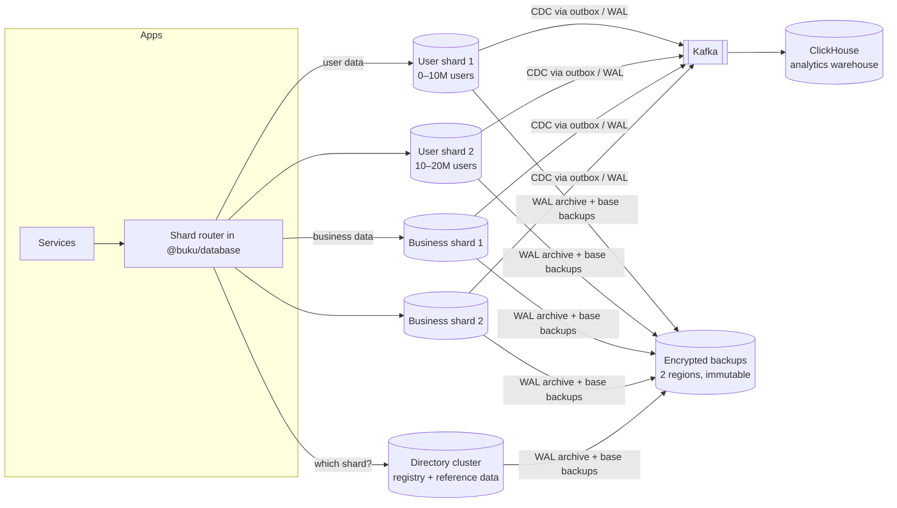
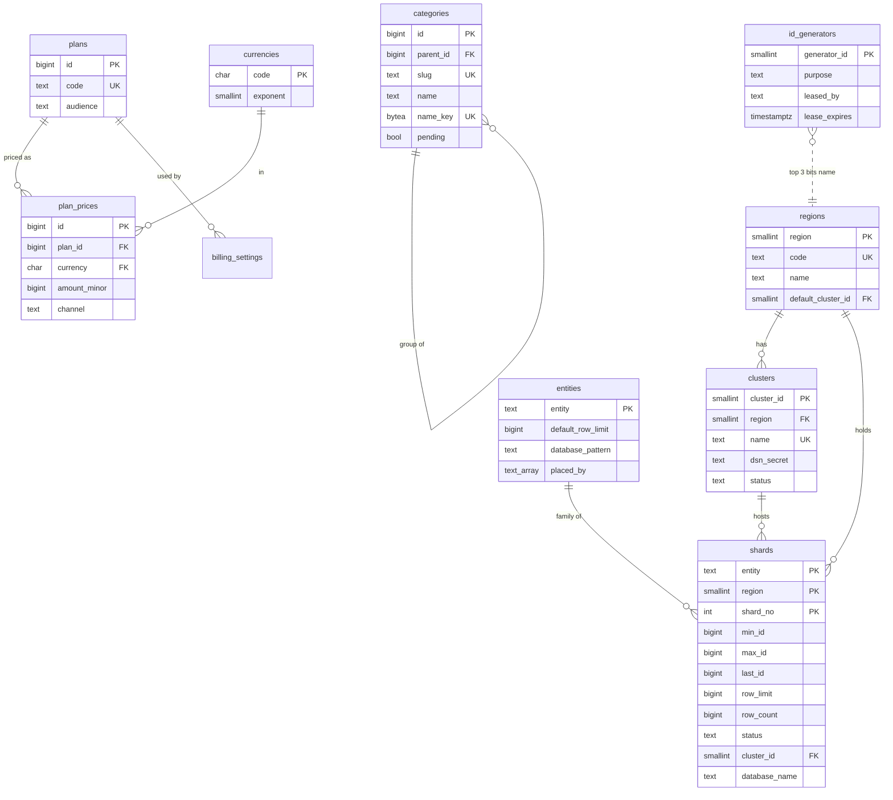
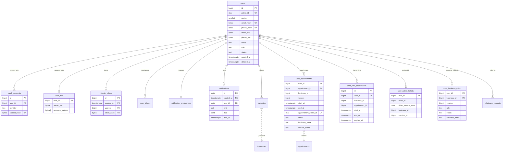
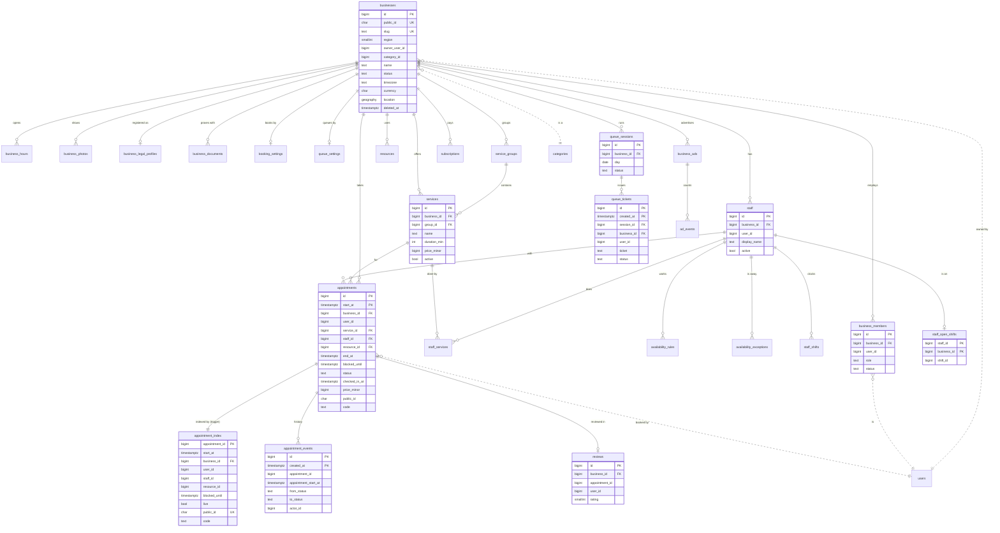
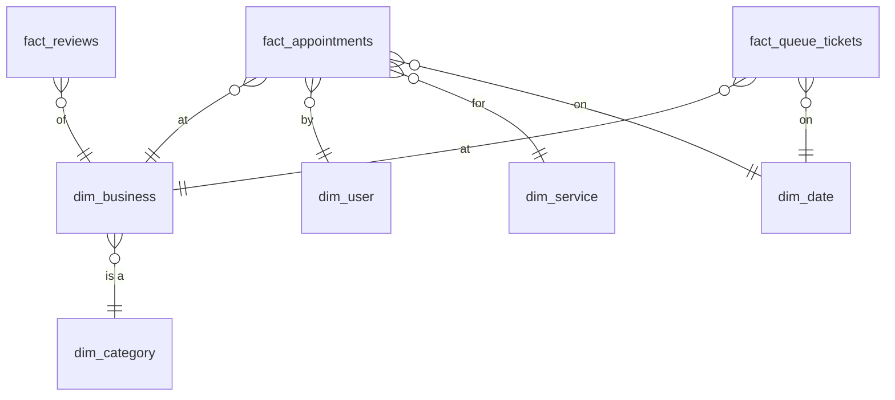

# BUKU database architecture (v2)

The database BUKU is built on from here: designed for hundreds of millions of people in many
countries, for recovery from any disaster, and for security that survives a leaked backup or a
compromised service. Every decision below has a number (DB-…) and a reason. Where this document
and the code disagree, this document is the plan and the code is the state; the build phases at
the end say what is done.

Status (2026-10-31): **D1, D2 and D3 are built (§15).** v2 has the directory, the shard
registry, ID generators and the router; global lookups; user and business shards provisioned from
the registry; reference data copied by replication; the search catalog; each service's rights
everywhere; and its own development data (D2e). Every service runs on v2 through the data plane,
the website and every test run on it too, and v1's `buku` database has left the stack (D3j).
**Next: D4** — backups, a tested restore, TLS and monitoring; then D5 (proof at scale). Website
work resumes now that D3 is done (DB-000).

---

## 1. Why now (DB-000)

**Decision:** rebuild the database now, before more of the website, not after it.

**Why:**

- There is no production data. Every change below (new key types, new tables, partitioning,
  sharding) is a rebuild today and a months-long, risky data migration later.
- Every website page built on the current schema is more code to rework. The key change alone
  (DB-002) touches every service and page.
- What can wait does wait: physical shard servers, cross-region replicas and backup servers are
  deployment work (Phase 5). The schema, the shard registry, the routing code, partitioning,
  indexing and the backup set-up are designed and built now and run with one shard locally.

---

## 2. What the current database is (audit, 2026-10-16)

Measured on the development database, not guessed:

| Finding                                         | Detail                                                                                | Verdict                                                                                                                                                                  |
| ----------------------------------------------- | ------------------------------------------------------------------------------------- | ------------------------------------------------------------------------------------------------------------------------------------------------------------------------ |
| 56 tables (54 `public`, 1 `ai`, 1 `extensions`) | one database, one schema for every service                                            | needs per-domain placement (DB-004)                                                                                                                                      |
| 3 partitioned tables                            | `audit_logs`, `notifications`, `ad_events`, monthly by `created_at` (272 partitions)  | right idea, too few; nothing else that grows without end is partitioned (DB-006)                                                                                         |
| Primary keys                                    | `uuid` (UUIDv7, time-ordered) on 51 tables                                            | works, but 16 bytes in every key and index, and unreadable as ranges (DB-002)                                                                                            |
| Indexes                                         | most tables have more than the primary key (appointments 12, businesses 12, users 9)  | **23 foreign keys have no index** (e.g. `appointments.service_id`, `checked_in_by_id`, every `reviewed_by_id`): deleting a user or a service scans whole tables (DB-007) |
| Hashes                                          | blind indexes and token hashes stored as 64-character hex (`char(64)`): 64 bytes each | twice the bytes of the same value in binary, four times what a lookup needs (DB-008)                                                                                     |
| Encrypted fields                                | base64 text (≈112 bytes for an email)                                                 | ~25% larger than binary (DB-008)                                                                                                                                         |
| Money                                           | `numeric(12,2)`                                                                       | exact, but slower to sum than integers (DB-009)                                                                                                                          |
| Access                                          | a login role per service, granted only its own tables (D-092)                         | good; kept                                                                                                                                                               |
| Row-level security                              | on 1 table                                                                            | defence in depth is thin (DB-020)                                                                                                                                        |
| Encryption in transit                           | `ssl = off` (development)                                                             | production must require TLS 1.3 (DB-020)                                                                                                                                 |
| Backups                                         | `archive_mode = off`, no backup schedule                                              | **no point-in-time recovery, no disaster recovery** (DB-030…035)                                                                                                         |
| Sharding                                        | none; no registry                                                                     | needed before ~10M users (DB-010…015)                                                                                                                                    |

What is already right and stays: field-level encryption of personal data with blind indexes
(D-083), least-privilege service roles (D-092), an outbox for events, append-only audit logs,
exclusion constraints that make double bookings impossible (D-036), soft deletes.

---

## 3. Targets the design is built for

|                             | Target                                                                                             |
| --------------------------- | -------------------------------------------------------------------------------------------------- |
| People                      | 100M+ customers, 10M+ businesses, in many countries                                                |
| Bookings                    | ~2 billion appointments a year at full scale; queue tickets similar                                |
| Reads                       | p99 < 20 ms for a single-entity read; p99 < 100 ms for a business's day                            |
| Writes                      | 50k bookings/s at peak across the fleet (scales by adding shards)                                  |
| RPO (data that may be lost) | 0 for a server failure; ≤ 1 minute for a whole-region disaster                                     |
| RTO (time to recover)       | ≤ 1 minute automatic failover in a region; ≤ 1 hour to another region                              |
| Backups                     | point-in-time recovery for 35 days; monthly copies for 1 year; immutable copies in a second region |
| Residency                   | a person's or business's data can be kept in its region (e.g. EU)                                  |

---

## 4. Topology



- **Directory cluster** (one per deployment, highly available): the shard registry, ID generator
  leases, and small reference tables every shard needs (categories, plans, settings).
- **User shards**: everything that belongs to one person.
- **Business shards**: everything that belongs to one business, including its appointments and
  queues.
- **Logical vs physical shards (DB-011):** a shard is a logical unit (a numbered database). Many
  logical shards can live on one physical cluster at first and be moved to their own cluster later
  without changing any ID. Locally and at launch: every logical shard on one cluster.
- Each physical cluster: 1 primary + 1 synchronous standby (another zone) + 1 asynchronous replica
  (another region), managed by Patroni, behind PgBouncer (DB-031).

---

## 5. Identifiers

### DB-001 · Every row has a 64-bit internal ID and, where it is ever shown, a public ID

**Decision:** primary keys are `bigint` (8 bytes). Anything that appears in a URL, an API response
or a receipt also has a `public_id`: 12 characters of Base62 from a cryptographic random source
(71 bits).

**Why:** `bigint` keys halve the size of every primary key, foreign key and index compared with
`uuid` (16 bytes): at 2 billion appointments with five keys each that is ~80 GB less, before
indexes, and smaller indexes stay in memory. Internal IDs are never shown, because ordered IDs can
be counted and guessed ("business 1,000,451 exists, so does 1,000,452"), which leaks business
volume and invites enumeration attacks. Public IDs are random, so they leak nothing.

### DB-002 · Internal IDs are time-ordered "snowflake" IDs, made without a central counter

**Decision:** a 64-bit ID made of three parts:

```
 0 | 41 bits: milliseconds since 2026-01-01T00:00:00Z | 10 bits: generator | 12 bits: sequence
     (good until 2095)                                 (1,024 generators)   (4,096 IDs per ms each)
```

- **Generators** are leased from the directory (`registry.id_generators`, DB-013) by each running
  service instance, so two instances never share one. A lease lasts 60 seconds and is renewed every
  20; one that isn't renewed expires, and an expired generator is handed out again only 30 seconds
  later. The instance itself stops making IDs 5 seconds before its lease could run out, by its own
  monotonic clock, even if it can't reach the directory to hear so (`LeasedIdGenerator`). So an
  instance that freezes and wakes up late can never make the same IDs as its successor.
- The **top 3 generator bits name the region** (8 regions), so an ID says where it was made
  without a lookup: `(id >> 19) & 7`.
- Of each region's 128 generators, 120 are for service instances and the last 8 for **databases'
  own inserts**: `ids.buku_id()` makes IDs inside a database (migrations, seeds, back-fills) from
  the generator set on it (`ALTER DATABASE … SET buku.generator_id`).
- When more than 4,096 IDs are asked for in one millisecond, or the clock steps backwards, a
  generator moves its own clock on instead of waiting or repeating, so IDs stay unique and in order.
- IDs travel between services and to the website as **decimal strings** (JSON numbers lose
  precision past 2⁵³), and anything that isn't a positive 64-bit decimal is refused before it
  reaches a query (`idFromString`). The code is `@buku/common` (`IdGenerator`, `parseId`,
  `publicId`) and the directory migration (`ids.next_id`), with the same layout and epoch, tested
  against each other.

**Why:** time-ordered IDs keep inserts at the end of every index (no random page splits, unlike
UUIDv4), sort by creation time for free, and let partitions be pruned by ID range. No central
sequence means no single point of failure and no round trip per insert. 4M IDs per second per
generator is far beyond need.

**Not chosen:** keeping UUIDv7 (twice the size, awkward ranges); a central sequence per table
(a single point of failure, and block allocation adds complexity for nothing the snowflake doesn't
already give).

### DB-042 · What APIs show: public IDs for what people share, row IDs only inside a business

**Decision:**

- **People, businesses and appointments** appear in URLs, API responses and receipts by their
  **public ID** (12 Base62 characters, DB-001), never their internal ID. A business is also
  reached by its slug. Each is found again through a global handle (DB-018) or, for an
  appointment, through its business or the person's own list.
- **Rows that only exist inside a business** (its services, team, resources, hours, photos,
  documents, queue tickets) appear by their **64-bit ID as a decimal string**, always under their
  business (`/businesses/<public id>/services/<id>`), behind authorization and row-level
  security.
- **A person's sign-in token** carries their own internal ID (as a decimal string) in `sub`,
  plus whether they must still change a temporary password (D-034), which lives on their shard
  and is checked by services without another lookup.
- **Events** between services carry internal IDs (an internal channel).
- Validation: `zPublicId` and `zId` in `@buku/common` (a decimal string becomes a bigint, anything
  else is refused before it reaches a query); JSON never carries a 64-bit number (it would lose
  precision).

**Why:** public IDs are random, so the things people share and link to can't be counted or
guessed (DB-001). A row inside a business is only ever reached by someone already allowed into
that business, so its snowflake reveals nothing they can't see, and giving every child row a
second, random ID would cost an index per table for no protection. Snowflakes do show when a row
was made, which is visible on the page anyway.

---

## 6. Sharding

### DB-010 · Shard by owner: people on user shards, businesses on business shards

**Decision:** two shard families.

- **User shards** hold what belongs to one person: account, sign-in, tokens, devices,
  preferences, notifications, favourites, and _their view_ of their bookings and queue tickets.
- **Business shards** hold what belongs to one business: profile, team, services, staff,
  schedules, **appointments**, queues, reviews, billing, ads.

Every child row lives on its parent's shard (**co-location**), so every everyday query and join is
on one shard: a business's day, a person's bookings, a service's staff.

**Why:** the busiest queries are "this business's day" and "this person's things". Appointments go
with the business because availability, double-booking checks and the front desk all read a
business's appointments together, under one lock.

### DB-011 · Range shards of 10 million, a limit that can be changed at any time

**Decision:** each shard family has a registry (DB-013). A shard covers one range of internal
IDs: `min_id` from its first row, `max_id` set when it fills. A shard accepts new rows until its
`row_limit` is reached, then closes and the next one opens.

- Shards are made ahead of need as **`ready`** (their database created and waiting), so opening
  the next one is a row update in the same transaction as the row that filled the last, never a
  wait for provisioning. Operators keep two or more ready per family and region.
- A shard closes at the **highest ID it has taken** (`last_id`), not at the ID that happened to
  fill it: IDs from many instances arrive slightly out of order, and closing at a late, lower one
  would put rows already placed inside the next shard's range. An ID made just before the switch
  that arrives just after it still goes to the shard whose range holds it, and is counted there.
- If a shard fills and **no shard is ready**, nobody is turned away: the open shard keeps taking
  rows past its limit, and one alert is raised (`registry.alerts`). The first placement after a
  ready shard is added closes it and resolves the alert.

- Default limits: **users 10,000,000 per shard** (the owner's brief); **businesses 1,000,000 per
  shard**, because one business brings far more rows than one person (appointments, tickets,
  reviews).
- The limit is a column, changed with one `UPDATE` (audited). Lowering it below the current count
  closes the shard at the next new row; raising it lets a shard keep filling.
- Because IDs only grow, the ranges never overlap: finding a row's shard is "the shard whose range
  contains this ID", in the same region (the region is read from the ID, DB-002).

**Why:** this is the owner's design, and it gives shards a fixed, known size, so capacity
planning, backup time and restore time per shard are predictable.

**The trade-off, handled:** all new people sign up on the newest user shard, so it gets the most
new activity. That's why shards are _logical_ (DB-012): the newest shard starts on the strongest
cluster, older and quieter shards move to cheaper clusters, and moving a shard never changes an
ID.

### DB-012 · Logical shards on physical clusters

**Decision:** `registry.clusters` lists physical clusters (region, the name of the setting that
holds its address, status); each shard row points at one. The address is host, port and TLS
options only: every role signs in with its own credentials, so the registry never holds a
password and one address serves every service. Moving a shard means copying it to another cluster
(logical replication), then switching the pointer in one transaction while writes for that shard
pause for seconds.

**Making shards real** (`scripts/provision-shards.ts`, `pnpm db:shards`; the `db-shards`
container): for every shard in the registry that isn't retired, ready ones included, it creates
the database on its cluster from `template1` (so it starts with every extension, `pg_partman`
included), takes away the template's default grants (DB-023), applies its family's migrations as
the schema owner, records which shard it is (`buku.shard = 'user:0:1'`), and schedules its hourly
partition upkeep in `pg_cron`. It is idempotent: run it after adding shards and after every
release. Each shard keeps its own migration history, so one that missed a release is brought up
to date on the next run.

**Why:** shards can be rebalanced and tiered without downtime or any change to IDs or code.

### DB-013 · The registry

Its own database, `buku_directory` (the directory cluster in production), schemas `registry` and
`ids`. The full definition, with every constraint, is
`packages/database/prisma/directory/migrations/20261016120000_registry/migration.sql`; in short:

| Table                    | One row per                         | What it holds                                                                                                                                                                                 |
| ------------------------ | ----------------------------------- | --------------------------------------------------------------------------------------------------------------------------------------------------------------------------------------------- |
| `registry.regions`       | region (0..7, the code inside IDs)  | `code` ('pk'), name, active, the default cluster for new shards                                                                                                                               |
| `registry.entities`      | shard family ('user', 'business')   | the default `row_limit` for new shards, the database name pattern (`buku_{entity}_{region}_{shard}`), `placed_by`: the database roles allowed to place its rows                               |
| `registry.clusters`      | physical cluster                    | region, name, `dsn_secret` (the **name** of the secret holding its connection string: a check refuses anything that looks like a connection string), status (active, draining, retired)       |
| `registry.shards`        | logical shard                       | family, region, number; `min_id`, `max_id`, `last_id`; `row_limit`, `row_count`; status (ready, open, full, read_only, moving, retired); cluster; database name; when created, opened, closed |
| `registry.id_generators` | generator (1,024)                   | purpose (service, database), who holds the lease, until when                                                                                                                                  |
| `registry.changes`       | change to any table above           | when, which database role, who asked (`buku.actor`), the row before and after                                                                                                                 |
| `registry.version`       | (one row)                           | a number that goes up with every change; routers re-read when it moves                                                                                                                        |
| `registry.alerts`        | open problem                        | a shard that filled with none ready to take over                                                                                                                                              |
| `ids.state`              | generator used inside this database | the last millisecond and sequence                                                                                                                                                             |

The database guarantees the rules, whatever a caller sends: one open shard per family and region
(a unique index); ranges that never overlap (an exclusion constraint); a `ready` shard has no
range, an open one has no end, a full one has one; `last_id` inside the range; names, codes,
patterns and role lists in strict formats (no spaces, quotes, markup or emoji can get in).

**Placing a new person or business** is `registry.place(family, id)`, one short transaction on
the directory: it checks the caller's role is in the family's `placed_by`, locks the shard whose
range holds the ID (opening the first ready one if the family has none open yet), counts the row,
moves `last_id`, and closes and hands over at the limit (DB-011). If the shard it waited for filled
meanwhile, it looks again and finds the next one. 400 placements at once, arriving in random order,
are counted exactly, every row on the shard whose range holds it (tested).

**Finding an existing row's shard** costs no round trip almost always. Every service keeps a copy
of the registry (`ShardRouter`, a few hundred rows) and trusts it only where it can't be out of
date: a closed range never changes, and in the open shard every ID up to `last_id` stays there for
good. Only an ID newer than that might belong to a shard that opened a moment ago; for those the
router first checks the registry (one tiny query, shared by every lookup waiting at that moment).
It also re-reads by itself every 5 seconds when the version has moved.

**Who may do what:** services read the registry and call its functions, and never write its
tables (`DIRECTORY_ACCESS` in `packages/database/src/access.ts`, applied by
`scripts/apply-access.ts`). Leasing, placing and routing are functions; changing the layout is for
operators (the owner role, through reviewed tooling), and every change lands in
`registry.changes`.

### DB-014 · Rules that cross shards

- **No database foreign keys across shards** (they can't exist). A business's owner is a person on
  a user shard: the business row keeps `owner_user_id` as a plain `bigint`, checked by the service
  when written, and kept consistent by events (e.g. a deleted person's businesses are handled by the
  `users.deleted` consumer, as today).
- **One appointment at a time per person, across all businesses (D-036)** stays a database
  guarantee: the booking first claims the time on the person's shard in
  `user_time_reservations` (an exclusion constraint on `(user_id, time range)`), then writes the
  appointment on the business shard; if the second step fails, the claim is released. A sweeper
  removes claims with no appointment after 2 minutes.
- **One queue at a time per person** works the same way (`user_active_tickets`, one row per person).
- **"My bookings" and "my businesses"** are read from small index tables on the person's shard
  (`user_appointments`, `user_business_roles`), kept up to date from the business shards' outbox
  events. They hold only what a list needs (IDs, times, names), so the person's pages are one-shard
  reads.

### DB-015 · Reference data is global and copied, not sharded

Currencies, kinds of business, plans and prices, billing and notification settings: a few thousand
rows that many queries join with. They live on the directory (schema `reference`) and are copied,
read-only, to every business shard and to the catalog (DB-041) by PostgreSQL **logical
replication**, so those joins stay local. User shards don't keep a copy: nothing there joins with
it yet, and every copy costs a replication slot (adding one is a flag in `SHARD_FAMILIES`).

- **The source:** `reference.*` on the directory, seeded by migration with v1's final data and
  fixed IDs (127 kinds of business, 8 plans, 6 prices, the billing and notification settings), plus
  38 currencies with their ISO 4217 minor units. Later rows (an owner's suggested kind, D-098) get
  snowflake IDs. Admins change it there, with every rule in a CHECK.
- **Published** as `buku_reference`. A new reference table is added to it in its own migration (a
  test fails otherwise), and the same columns are added to the copies (a test compares the columns
  of every copy with the source).
- **Copied by** `buku_replicator` (`LOGIN REPLICATION`, reads only the published tables;
  `BUKU_REPLICATOR_PASSWORD`). Provisioning makes each copy's replication slot on the directory
  first and then the subscription (that also works on one server, where letting `CREATE
SUBSCRIPTION` make the slot would wait on itself); on later runs it refreshes the subscription
  (new tables, a rotated password).
- **A copy is never written by anyone** but replication: no grants beyond `SELECT`, no foreign keys
  pointing at it from shard rows (a replicated delete would not wait for them), no checks (the
  source holds those). A change on the directory reaches every copy within a second or two.
- **Dropping a database drops its copy first** (`dropDatabase`: subscription, then slot). A slot
  nobody reads keeps every WAL file on the directory from then on, until its disk fills; slots
  are monitored in D4.
- Triggers that must react to a replicated change (the catalog's search documents when a kind is
  renamed) are marked `ENABLE ALWAYS`: replication skips ordinary triggers.

A kind of business is shared by everyone, so its name is held to what can't harm anyone even if
it arrives some other way than the API: no control or invisible characters, no characters used in
markup or code, no emoji or pictographs, no stray spaces, at least two letters, any script.

### DB-017 · Built to be changed: what will change is a row, not code

**Decision:** everything about the layout that will change as BUKU grows is data in the registry,
checked by constraints and logged: regions, clusters, shard families, shards, limits, and who may
place what. Statuses are `text` with `CHECK` constraints rather than enum types, so adding one is a
one-line constraint change, not a type migration. Routers re-read the registry when its version
moves, so no change needs a deploy or a restart.

| To…                                | Do this (as an operator, with `SET buku.actor = '<who and why>'` so the log says)                                                                   |
| ---------------------------------- | --------------------------------------------------------------------------------------------------------------------------------------------------- |
| change a shard's limit             | `UPDATE registry.shards SET row_limit = … WHERE entity = … AND region = … AND shard_no = …` (lower than its count: it closes at its next row)       |
| change the limit for new shards    | `UPDATE registry.entities SET default_row_limit = … WHERE entity = …`                                                                               |
| add capacity                       | `SELECT * FROM registry.add_shard('user', 0)` (a `ready` shard, numbered next, named by the pattern; D2's provisioning creates its database)        |
| add a region                       | insert into `registry.regions` (a free code 0..7) and a cluster for it; set its default cluster; add ready shards. Its 128 generators already exist |
| add a cluster, or move new shards  | insert into `registry.clusters`; point the region's `default_cluster_id` at it                                                                      |
| add a shard family                 | insert into `registry.entities` (name, limit, database pattern, `placed_by`); add ready shards; the router needs no change                          |
| let another service place a family | `UPDATE registry.entities SET placed_by = …`                                                                                                        |
| move a shard to another cluster    | copy it (logical replication), set `status = 'moving'` for the switch-over seconds, then `cluster_id = …` and back to `full`/`open` (DB-012)        |
| add a status, an alert kind        | change the `CHECK` constraint in a migration                                                                                                        |

**What is fixed for good:** the ID layout and its epoch (DB-002). Every ID already made depends on
them; changing either would break their order and their region bits. Everything else can change.

**Why:** the owner's brief: the database must keep up with features added over the years. A
registry that is data, with its rules in constraints and a log of every change, can be adjusted
safely by an operator in minutes, and a mistake is visible in the log and refused by the
constraints rather than discovered later in production data.

### DB-018 · Global lookups: what a person or business is found by, unique across every shard

**The problem:** signing in starts from an email, a phone number or a Google or Apple account; a
business page starts from its address (`/b/<slug>`) or public ID; a WhatsApp message arrives from
a number. None of these says which shard to look on, and a unique index on one shard can't stop
the same email being registered on another.

**Decision:** one table of **handles** on the directory, `lookup.handles` (kind, key → owner ID),
with its kinds in `lookup.handle_kinds`. The primary key `(kind, key)` makes every handle unique
across all shards. Finding someone is two steps with no search: the handle gives the ID, and the
ID gives the shard (DB-011).

| Kind                        | Key                                                                 |
| --------------------------- | ------------------------------------------------------------------- |
| `user.email`, `user.phone`  | the 16-byte keyed blind index (DB-008), never the address or number |
| `user.google`, `user.apple` | the blind index of the account's subject                            |
| `user.public_id`            | the 12 characters                                                   |
| `user.employee_login`       | the business's ID (8 bytes, big-endian) + the username (D-034)      |
| `user.whatsapp`             | the blind index of the linked number                                |
| `user.push_token`           | the blind index of the device's token (a device is one person's)    |
| `business.public_id`        | the 12 characters                                                   |
| `business.slug`             | the slug                                                            |
| `business.subscription`     | a hash of a Google Play or App Store subscription's own ID          |

- **Written only through functions:** `lookup.claim` (taking a handle someone else has is
  refused and says by whom; only kinds that move between people by design, like a device's push
  token, can be taken over), `lookup.release` (only by its owner), `lookup.release_all` (an
  erased account), `lookup.find`. Each checks that the caller's role is one of the kind's
  `writers` (the auth service for emails, the notification service for WhatsApp numbers, the
  business service for slugs) and that the key is the kind's size.
- **Split into 16 parts by a hash of the key** from the start (two or three handles per person
  is hundreds of millions of rows), so it never has to be rebuilt to be split.
- A new kind is a row (DB-017), logged like any other change to the layout.
- Child rows (an appointment's public ID, a queue ticket) don't need handles: they are always
  reached through their parent (the person's `user_appointments`, or the business whose page it
  is), whose shard is already known.

**Why not a hash of the email to pick the shard?** It would tie every person to a shard by their
email (changing it would mean moving them) and would still need a table for Google accounts,
phones and slugs. One small, partitioned table does all of it.

---

## 7. Partitioning and retention

### DB-006 · Partition what grows without end, by time; leave the rest alone

**Decision:** declarative range partitions, created ahead and dropped behind by `pg_partman`,
scheduled by `pg_cron`:

| Table (shard)                          | Partitioned by | Partition size | Kept online           | Then                                            |
| -------------------------------------- | -------------- | -------------- | --------------------- | ----------------------------------------------- |
| `appointments` (business)              | `start_at`     | month          | 25 months             | detached to cheap storage, still restorable     |
| `appointment_events` (business)        | `created_at`   | month          | 25 months             | same                                            |
| `queue_tickets` (business)             | `session_date` | month          | 13 months             | same                                            |
| `staff_shifts` (business)              | `started_at`   | month          | 25 months             | same                                            |
| `notifications` (user)                 | `created_at`   | month          | 6 months              | dropped (they're also in email/push)            |
| `refresh_tokens` (user)                | `expires_at`   | month          | until expiry + 7 days | dropped                                         |
| `outbox_events` (every shard)          | `created_at`   | day            | 7 days after sent     | dropped                                         |
| `processed_events` (every consumer)    | `occurred_at`  | day            | 14 days               | dropped                                         |
| `audit_logs` (every shard)             | `created_at`   | month          | 25 months online      | copied to immutable storage first, kept 7 years |
| `ad_events`, `ai_call_logs` (business) | `created_at`   | month          | 13 months             | dropped                                         |
| `webhook_deliveries` (business)        | `event_at`     | week           | 30 days               | dropped                                         |

**Why:** these are the tables that reach billions of rows. Monthly partitions keep each one's
indexes small, let queries on "this month" touch one partition, and turn deleting old data into
dropping a partition (instant, no bloat, no vacuum storm). Small tables (settings, services, staff)
gain nothing from partitions and pay overhead, so they stay plain.

**Keys on partitioned tables:** PostgreSQL requires the partition key in a partitioned table's
primary key, so `appointments` has `PRIMARY KEY (id, start_at)` and rows that point at an
appointment carry both (`appointment_id`, `appointment_start_at`). The snowflake ID alone stays
unique (DB-002).

**Made by `pg_partman`, run hourly by `pg_cron`** in every shard database, as the tables' owner:
partitions exist ahead (3 months for monthly tables, a week for daily ones, and 25 months for
refresh tokens, whose sessions can slide for up to two years) and expired ones are dropped by
each table's retention. `infinite_time_partitions` keeps them coming through a quiet spell. A
`_default` partition catches anything outside the range, and a row there is a monitoring alert
(D4).

### DB-019 · Ledgers that must catch duplicates are partitioned by the event's own time

**Decision:** `processed_events` (a consumer's "already done" list) is partitioned by the
event's `occurred_at` from its envelope, not by when it was processed, with the key
`(consumer, event_id, occurred_at)`.

**Why:** a unique key on a partitioned table only holds within a partition. Partitioned by
processing time, an event delivered at 23:59 and again at 00:01 would land in two partitions and
be processed twice. An event's own time never changes, so every redelivery lands in the same
partition and the key catches it, while old days are still dropped whole.

`notification_marks` (each scheduled message sent once) is not partitioned: its keys repeat over
months, so it is one table keyed `(user_id, key)` and a sweeper removes marks older than 13
months, in small batches, through a BRIN index on `created_at`.

### DB-024 · Rules that must hold across partitions

PostgreSQL enforces a unique key or an exclusion constraint on a partitioned table only within
each partition, unless the key includes the partition key; and a foreign key that points into a
partitioned table stops its old partitions from being detached. So, everywhere:

- **Nothing points into a time-partitioned table** with a foreign key. Rows that refer to an
  appointment (its events, its payment, its review) carry `(appointment_id,
appointment_start_at)`, written in the same transaction; old months can always be detached.
  Foreign keys _from_ partitioned tables to plain ones (an appointment's service and employee)
  are kept.
- **Where the rule's own key fixes the partition, the partition key joins the key**, and the rule
  stays exact: a queue ticket is partitioned by its session's date, which its session fixes, so
  "one number per session" is `UNIQUE (session_id, ticket_number, session_date)`, and the
  composite foreign key to the session makes the date the session's own. The same holds for
  webhook deliveries (by the event's time) and the idempotency ledger (DB-019).
- **Where it doesn't, one small unpartitioned index table holds the rule**, kept by a trigger in
  the same transaction, written by nothing else: `appointment_index`, one row per appointment
  with its partition key. It makes public IDs unique and codes unique within their business
  across every month, finds an appointment by either without searching every month, and refuses
  double booking with exclusion constraints on the live appointments (pending, confirmed): an
  employee from start to the end of the clean-up time, a resource, and a customer at the same
  business. A violation aborts the appointment's own insert, as v1's constraints did.
- **An appointment's time never changes** (a trigger refuses it): moving one makes a new
  appointment (`rescheduled_from_id`), as rescheduling already does. So no row ever changes
  partition, and everything that refers to it stays right.
- An employee's one open shift is `staff_open_shifts`, keyed by the employee, kept by a trigger
  on the monthly `staff_shifts`.

---

## 8. Indexes and storage

### DB-007 · Index rules

1. **Every foreign key has an index** that starts with its columns (fixes the 23 gaps found).
2. Every index on a sharded table **starts with the owner key** (`business_id`, `user_id`) when
   queries filter by owner, so a business's or person's rows are next to each other.
3. **Partial indexes** for the rows that matter: `WHERE deleted_at IS NULL`, `WHERE status IN
('pending','confirmed')`.
4. **Covering indexes** (`INCLUDE`) for the lists that run all day (a business's day, a person's
   upcoming visits), so they never touch the table.
5. **BRIN indexes** on time columns of the biggest append-only tables (audit, events): a few
   kilobytes instead of gigabytes.
6. **No unused or duplicate indexes:** `pg_stat_statements` and `pg_stat_user_indexes` are reviewed
   every release; an index nothing uses is removed.
7. Every index added in a migration is created `CONCURRENTLY` on large tables.

### DB-008 · Hashes and encrypted values are stored as bytes, at the size they need

| Value                                             | Now                             | v2                                                         | Why                                                                                                                                                    |
| ------------------------------------------------- | ------------------------------- | ---------------------------------------------------------- | ------------------------------------------------------------------------------------------------------------------------------------------------------ |
| Blind indexes (email, phone, registration number) | 64 hex chars                    | `bytea`, **16 bytes** (HMAC-SHA-256 truncated to 128 bits) | 128 bits is collision-free at any number of people we'll ever have (a collision needs ~2⁶⁴ values) and still keyed (the key never leaves the services) |
| Token hashes (refresh, reset)                     | 64 hex chars                    | `bytea`, 32 bytes (SHA-256)                                | tokens are random 256-bit values; the full hash keeps them unguessable                                                                                 |
| Encrypted fields (email, phone, secrets)          | base64 text                     | `bytea`                                                    | ~25% smaller, no encoding step                                                                                                                         |
| Password hashes                                   | Argon2id PHC string (≈97 chars) | unchanged                                                  | the standard self-describing format; parameters can change per user. Its size is fixed and small next to everything else                               |
| IP addresses (ads, security)                      | hex hash                        | `bytea` 16 bytes, keyed                                    | same as blind indexes                                                                                                                                  |

At 100M people this alone saves ~30 GB of table and index space on user shards.

In code (`@buku/common`): `indexer.digest16()` is the first 16 bytes of the same HMAC as v1's
hex hash, so every v1 blind index becomes its v2 form by keeping its first 32 hex characters (no
email has to be read again); `cipher.encryptBytes()` / `decryptBytes()` are the same AES-256-GCM,
keys and context as bytes (`0x01 | key id length | key id | iv | ciphertext || tag`), and
`ciphertextToBytes()` turns a v1 value into those bytes without the key.

### DB-009 · Money in integer minor units

**Decision:** amounts are `bigint` in the currency's minor unit (paisa, cents), with the
currency's exponent from a reference table.

**Why:** exact like `numeric`, but 8 bytes, and sums and comparisons are integer operations (much
faster in reports). The payment industry stores money this way.

### DB-016 · Rows laid out to waste nothing

Columns are ordered by size in every `CREATE TABLE` (8-byte, then 4-byte, 2-byte, 1-byte, then
variable length), so PostgreSQL's alignment adds no padding. On a row with mixed types this saves
10–30% of the row header and padding.

---

## 9. Diagrams (entity–relationship)

Solid lines are foreign keys inside a shard. Dotted lines (`..`) are references across shards,
kept by the services and events (DB-014). Keys: `id` is the internal `bigint`; `public_id` is shown
only where it exists.

### 9.1 Directory and reference data



### 9.2 A person (user shard)



### 9.3 A business (business shard)



### 9.4 Analytics warehouse (ClickHouse, star schema)



Facts carry the same internal IDs as the shards, so every join that is impossible across shards
(e.g. "bookings per category per city per month") is a plain join here (DB-040).

---

## 10. Table catalogue

Where every current table goes. "→" is its v2 name when it changes.

| Current table                                                                                                                                                                         | Home                         | Partitioned            | Notes                                              |
| ------------------------------------------------------------------------------------------------------------------------------------------------------------------------------------- | ---------------------------- | ---------------------- | -------------------------------------------------- |
| users                                                                                                                                                                                 | user shard                   | no (sharded)           | bigint id + public_id; bytea blind indexes; region |
| oauth_accounts, user_mfa, push_tokens, notification_preferences, notification_marks, whatsapp_contacts, favourites                                                                    | user shard                   | no                     | co-located by `user_id`                            |
| refresh_tokens                                                                                                                                                                        | user shard                   | weekly by `expires_at` | dropped after expiry                               |
| notifications                                                                                                                                                                         | user shard                   | monthly                | 6 months                                           |
| — (new) user_appointments, user_time_reservations, user_active_tickets, user_business_roles                                                                                           | user shard                   | no                     | DB-014                                             |
| businesses, business_members, business_hours, business_photos, business_documents, business_legal_profiles, business_reports, business_search_stats, booking_settings, queue_settings | business shard               | no                     | co-located by `business_id`                        |
| services, service_categories → service_groups, staff, staff_services, staff_photos, resources, availability_rules, availability_exceptions                                            | business shard               | no                     |                                                    |
| staff_attendance → staff_shifts                                                                                                                                                       | business shard               | monthly                |                                                    |
| appointments                                                                                                                                                                          | business shard               | monthly by `start_at`  | PK `(id, start_at)`                                |
| appointment_status_history → appointment_events                                                                                                                                       | business shard               | monthly                |                                                    |
| queue_sessions                                                                                                                                                                        | business shard               | no                     |                                                    |
| queue_entries → queue_tickets                                                                                                                                                         | business shard               | monthly                |                                                    |
| reviews, payments, subscriptions, plan_requests                                                                                                                                       | business shard               | no                     | user subscriptions stay dormant (D-101)            |
| business_ads, webhooks                                                                                                                                                                | business shard               | no                     |                                                    |
| ad_events, webhook_deliveries                                                                                                                                                         | business shard               | monthly / weekly       |                                                    |
| ai_receptionist_configs, ai_call_logs, ai.business_knowledge_chunks                                                                                                                   | business shard               | ai_call_logs monthly   |                                                    |
| audit_logs                                                                                                                                                                            | every shard                  | monthly                | + immutable archive (DB-022)                       |
| outbox_events, processed_events                                                                                                                                                       | every shard / consumer       | daily                  |                                                    |
| categories, plans, plan_prices, billing_settings, billing_channel_fees, billing_cost_items, notification_settings                                                                     | directory (copied to shards) | no                     | DB-015                                             |
| — (new) registry.*, currencies                                                                                                                                                        | directory                    | no                     | DB-013, DB-009                                     |

---

## 11. Security

### DB-020 · Defence in depth, layer by layer

1. **Network:** databases only on private networks; no public address; firewall allows only the
   service hosts and the bastion.
2. **Transport:** `hostssl` only, TLS 1.3 minimum, server certificate verified by every client
   (`sslmode=verify-full`).
3. **Authentication:** SCRAM-SHA-256; one login role per service (kept from D-092), each granted only
   its own tables and only the verbs it uses, in every kind of database: `USER_SHARD_ACCESS`,
   `BUSINESS_SHARD_ACCESS`, `CATALOG_ACCESS` and the directory's (`DIRECTORY_ACCESS`,
   `DIRECTORY_REFERENCE_ACCESS`) in `packages/database/src/access.ts`, applied to every shard in
   the registry by `apply-access`. A service with nothing in a kind of database can't even connect
   to it; reference copies, the appointment index and open shifts are written by no service; only
   auth reads credentials. No service uses a superuser or owns tables; the migrator role is used
   only by migrations.
4. **Row-level security** on every business-shard table as a second wall: each transaction sets
   `buku.business_id` (`forBusiness(tx, id)`: `SET LOCAL`, so a pooled connection never carries
   it over) and policies allow only that business's rows, for reading and for writing; with
   nothing set, nothing is visible. A bug that forgets a `WHERE business_id = …` returns nothing
   instead of another business's data. Work that is meant to span businesses (reminders, admin
   queues, ranking statistics) uses the service's second role, `buku_svc_<name>_all`: the same
   table rights, plus membership of `buku_all_businesses` with inherit (that role has no rights
   of its own, it only opens the policies). The service's login role may switch to it but
   doesn't inherit it, so it takes an explicit `forAllBusinesses(tx, service)` (`SET LOCAL ROLE`)
   in that one transaction; a request handler never does, and a query that forgets its business
   still sees nothing. Each service's reason is written next to it (`CROSS_BUSINESS`). The schema
   owner (migrations, upkeep) is exempt. A test fails if any table holding a business's rows
   lacks the policies.
5. **Field encryption** of personal data (AES-256-GCM, keys versioned and rotatable, D-083) and
   keyed blind indexes (DB-008): a stolen backup or disk shows no emails or phone numbers.
6. **Keys** live in a key manager (KMS), never in the database or its backups; services get them at
   start.
7. **Timeouts per role** (`statement_timeout`, `idle_in_transaction_session_timeout`, `lock_timeout`)
   so one bad query can't hold a shard.
8. **Encryption at rest** of every disk and every backup (DB-033).
9. **Replication's own credential:** each copy's subscription stores the replicator's connection,
   password included, readable only by superusers; the replicator can read the published reference
   tables and nothing else.

### DB-021 · People who touch the database

- No standing human access to production. Access is **break-glass**: time-limited (1 hour),
  requires two-step sign-in and a reason, read-only by default, and every statement is logged.
- Development and test data is always synthetic (the seed). Production data is never copied to
  any other environment.

### DB-022 · Audit that can't be rewritten

- `pgaudit` logs every DDL, role and permission change, and every human session.
- Application audit rows (`audit_logs`) are append-only for every role (no `UPDATE`/`DELETE`
  grant), and each month's partition is copied to object storage with **object lock** (WORM) before
  it leaves the database: kept 7 years.

### DB-023 · Shard databases grant nothing by default

**Decision:** when a shard database is made, the default privileges it inherits from `template1`
are taken away, so a table or partition the migrator creates is usable by nobody until a
migration or `apply-access` grants it. Grants are on the parent tables only, never a partition.

**Why:** with defaults on, every new table, and every partition `pg_partman` makes each hour, would
quietly be readable and writable by the app role, including the audit log's (v1 had to revoke
those one by one). With nothing by default, a forgotten grant is a loud "permission denied" in a
test, never a silent hole; and since partitions are reached only through their parent, a service
can't read or empty one directly.

---

## 12. Backups and disaster recovery

### DB-030 · Continuous archiving and point-in-time recovery

**Decision:** `pgBackRest` on every cluster: WAL archived continuously (`archive_timeout = 60s`),
a full backup weekly, differential daily, incremental every 6 hours. Point-in-time recovery to any
second in the last **35 days**.

**Why:** a full backup alone loses up to a day; with WAL, at most the last minute (and nothing for a
single-server failure, DB-031).

### DB-031 · High availability in a region

Each cluster: primary + **synchronous** standby in another zone (no committed write is ever lost if
the primary dies) + Patroni with a consensus store (etcd) for automatic failover in under a minute.
PgBouncer in front, so services reconnect without noticing.

### DB-032 · Another region

An asynchronous standby of every cluster in a second region (a few seconds behind), plus the
backups (DB-033). Region failover is a documented, rehearsed runbook (promote, switch the registry's
cluster pointers, switch DNS): **≤ 1 hour**.

### DB-033 · Where backups live

Two object stores in two regions, both encrypted (AES-256, keys in KMS), the second with object lock
(backups can't be deleted or altered for 35 days, even by an administrator: protection against
ransomware and mistakes). Monthly full backups kept 12 months.

### DB-034 · Restores are tested, not assumed

- **Every day:** `pgbackrest verify` checks every backup and WAL file.
- **Every week (automatic):** the latest backup of one shard, picked in turn, is restored to a
  scratch server, brought to a point in time, and checked: row counts against the source, sample
  checksums, and the service smoke tests. The result is a metric; a failure pages someone.
- **Every quarter:** a full region-failover exercise.

### DB-035 · Logical safety nets

Mistakes that replicate instantly (a wrong `DELETE`) are recovered by point-in-time restore of the
affected shard to a side server and copying back the rows. Soft deletes (`deleted_at`) and the
audit log make most mistakes reversible without a restore.

---

## 13. Analytics and joins

### DB-040 · Analytics run on a warehouse, never on the shards

**Decision:** every shard's changes stream to ClickHouse (outbox events today; WAL change data
capture with Debezium at scale) into the star schema of §9.4. Dashboards, reports, the profit
calculator and any cross-business question read the warehouse.

**Why:** questions across all businesses or all people need joins across shards, which a sharded
OLTP database can't do quickly, and heavy reports must never slow down booking. The warehouse is
built for scans and aggregates over billions of rows.

**Joins on the shards** are kept fast by co-location (DB-010): every join a page needs is inside
one shard, on indexed keys.

### DB-041 · Search, discovery and ad serving read one global catalog

**The problem:** "places near me", "barbers in Lahore", searching by name, and choosing which ads
to show all look across every business, and with businesses on many shards no single query can.
v1 does all of it in Postgres (full-text search, trigram name matching, PostGIS) on one table.

**Decision:** one **catalog** database: a row per business with what discovery needs (name,
kind, city, location, rating, opening state, ranking statistics, running ads), kept up to date
from the business shards' events. Search keeps v1's proven queries against it. The business shard
keeps its own location for its own distance checks (the queue's join radius, D-038).

Built in D2c (`buku_catalog`, `prisma/catalog`): `catalog.businesses` (with v1's search document,
name A, kind and its group B, active services B, description C, city D, and its map point, both
kept by triggers; GIN, trigram and GiST indexes), `catalog.services`, `hours`, `closures`,
`queues` (today's), `ads` (those that may run), and a reference copy (DB-015). Every row carries
the `version` of the newest read applied, so a late event never overwrites a newer one. The
search service keeps it from the business shards' events (D3h, D-120).

**Why not Elasticsearch now?** It is the next step if one Postgres catalog stops being enough
(tens of millions of businesses, or heavy relevance tuning). Until then a catalog of a few
million rows is fast in Postgres, exact, and has one less system to run.

---

## 14. Operations

- **Extensions:** `pg_stat_statements` (query costs), `pgaudit`, `pg_partman`, `pg_cron`,
  `btree_gist` (exclusion constraints), `pg_trgm` (search), `postgis` (places), `vector` (AI); all
  in the BUKU Postgres image.
- **Connection pooling:** PgBouncer in transaction mode per cluster; Prisma connects through it.
- **Monitoring:** replication lag, WAL archive lag, backup age, bloat, slow queries, connection
  saturation, partition coverage (a missing future partition is an alert).
- **Migrations:** expand → migrate → contract; every shard migrated by the same migration, tracked
  per shard; large indexes `CONCURRENTLY`.
- **Databases and admin-only extensions** (the directory, the catalog, `pg_cron`, `pgaudit`,
  `pg_stat_statements`, `pg_partman` in `template1` so every new shard database has them), and the
  roles `buku_all_businesses` and `buku_replicator`, are created by
  `scripts/prepare-databases.ts`, idempotent, before migrations: `pnpm db:prepare`, the `db-prepare`
  container, and CI.
- **Logical replication** needs `wal_level = logical`, with room for a slot and a worker per copy
  (`max_replication_slots`, `max_wal_senders`, `max_logical_replication_workers`,
  `max_worker_processes`; set in `docker-compose.dev.yml`).

---

## 15. Build phases

| Phase                 | What                                                                                                                                                                                                                                                     | Done when                                                                                                                                                 |
| --------------------- | -------------------------------------------------------------------------------------------------------------------------------------------------------------------------------------------------------------------------------------------------------- | --------------------------------------------------------------------------------------------------------------------------------------------------------- |
| **D1 Foundation** ✅  | Postgres image with the extensions; directory schema (registry, generators, settings, currencies); the ID generator (`@buku/ids`: TypeScript and `buku_id()` in SQL) and public IDs; the shard router in `@buku/database` (one shard per family locally) | unit and integration tests for IDs (uniqueness under concurrency, ordering, region bits), allocation (limit reached → next shard, limit changed), routing |
| **D2 Schema v2** ✅   | the new baseline: every table rebuilt per §5–§10 (bigint keys, public IDs, bytea hashes, money in minor units, partitions, every index, constraints, the new user-side tables), RLS policies, grants per service; a new seed. In five slices, below      | migrations apply on an empty database; the seed loads; constraint tests (double booking, overlaps, one queue) pass                                        |
| **D3 Services** ✅    | every service on v2 (auth, business, booking, queue, search, notification, billing, ads, analytics) through the router; the API keeps returning public IDs, so the website changes little                                                                | all unit, integration, acceptance and website tests pass                                                                                                  |
| **D4 Safety**         | pgBackRest in development (archive, backups, a restore script), TLS in development, pgaudit, partition maintenance jobs, monitoring queries; the restore drill as a script                                                                               | a restore to a point in time is demonstrated and tested in CI                                                                                             |
| **D5 Proof at scale** | a synthetic data set (10M people, 1M businesses, 200M appointments) on a test cluster; the slow-query review                                                                                                                                             | the targets in §3 met for the main queries                                                                                                                |

Website work resumes after D3.

**D1, as built (2026-10-16).**

- Postgres image with `pg_partman`, `pg_cron`, `pgaudit` and `pg_stat_statements` preloaded;
  `prepare-databases` creates `buku_directory` (and its test twin) and the admin-only extensions.
- The directory (DB-013, DB-017): regions, clusters, shard families, shards with ready shards and
  `last_id`, generator leases, the change log, the version and alerts; `registry.place`,
  `registry.route`, `registry.add_shard`, lease functions, `ids.next_id` / `ids.buku_id`.
- `@buku/common`: `IdGenerator`, `parseId`, `regionOfId`, `idFromString`, `publicId`. They live in
  the existing common package, next to `uuidv7`, rather than a new `@buku/ids`: every service
  already depends on it.
- `@buku/database`: `createDirectoryClient`, `LeasedIdGenerator`, `ShardRouter`; each service
  role's directory rights (`DIRECTORY_ACCESS`); a development seed (Pakistan, one local cluster,
  `user` 10M and `business` 1M per shard, two ready shards each).
- Tests: IDs (100,000 in one millisecond, clock going backwards, layout identical to SQL, bad
  input refused, public IDs unbiased); placement (rollover, late IDs, no ready shard, regions, 400
  at once), changes logged and versioned, constraints refusing bad data, rights, leases (including
  an instance cut off from the directory stopping by itself), the router (certain vs checked,
  shared checks, watching for changes).
- Two corrections to the design found while building it, both above: a shard closes at the highest
  ID it took, not the one that filled it (DB-011); a placement that waited for a shard that filled
  meanwhile looks again (DB-013).
- `currencies` moves to D2 with the rest of the reference data (DB-015), since they are copied to
  shards together. The shard databases themselves (`buku_user_pk_1`, …) are created by D2's
  provisioning; D1 records where they will be.

**D2, in slices.** The v2 databases are new databases next to v1's `buku`, which keeps serving the
website and services unchanged until D3 moves each service over; nothing is migrated in place.

| Slice                   | What                                                                                                                                                            |
| ----------------------- | --------------------------------------------------------------------------------------------------------------------------------------------------------------- |
| **D2a** ✅ (2026-10-16) | global lookups (DB-018); shard provisioning from the registry (DB-012, DB-023); the user shard (§9.2) with its partitions (DB-006, DB-019)                      |
| **D2b** ✅ (2026-10-17) | every business table (§9.3), appointments partitioned by month, the rules across partitions (DB-024), row-level security by business (DB-020)                   |
| **D2c** ✅ (2026-10-17) | reference data on the directory, copied to every business shard and the catalog by logical replication (DB-015); the search catalog (DB-041)                    |
| **D2d** ✅ (2026-10-17) | each service's rights on user and business shards, the catalog and the directory, in the access map; cross-business roles; applied by `apply-access` everywhere |
| **D2e** ✅ (2026-10-17) | the development data placed across shards through the registry and the router, as the services will; encrypted values as bytes                                  |

**D2a, as built (2026-10-16).**

- `lookup.handles` and `lookup.handle_kinds` on the directory (DB-018), with `claim`, `release`,
  `release_all` and `find`; ten kinds; 16 hash partitions; writers per kind.
- `scripts/provision-shards.ts` (`pnpm db:shards`, the `db-shards` container, CI): every
  registered shard created, stripped of default grants, migrated, tagged and given hourly
  partition upkeep. `pg_partman` is in `template1`; `pg_cron` runs jobs in background workers.
- The user shard (`prisma/user`): `users`, `user_mfa`, `oauth_accounts`, `refresh_tokens`
  (monthly, 25 months ahead), `push_tokens`, `notification_preferences`, `notifications`
  (monthly, 6 months), `notification_marks`, `whatsapp_contacts`, `favourites`,
  `user_appointments`, `user_time_reservations` (the exclusion constraint for one appointment at
  a time), `user_active_tickets`, `user_business_roles`, `audit_logs` (monthly, append-only),
  `outbox_events` (daily, 14 days, row-level security by service), `processed_events` (daily by
  the event's time, DB-019). Every status checked, every hash its size, every foreign key indexed.
- `@buku/database`: `ShardClients` (a pool per shard, opened on first use), `clusterUrl` /
  `shardUrl` (an address plus the caller's own credentials), the user shard's client.
- A cluster's address is a setting naming host and port only (`BUKU_DB_CLUSTER_LOCAL_1`).
- Tests: handles (one email per person across shards, take-over, release, sizes, writers, new
  kinds logged); provisioning (idempotent, partitions ahead, upkeep scheduled, shard tag); no
  default grants; the audit log append-only; malformed people refused; one appointment at a time;
  one queue at a time; a redelivered event caught across days; a sign-up end to end (placed,
  claimed, written, found again by email, the next shard opening at the limit).

**D2b, as built (2026-10-17).**

- The business shard (`prisma/business`): 38 tables. Every child carries `business_id` and points
  at its parent through `(id, business_id)`; money in minor units; every status checked.
  - **Time-partitioned:** appointments (25 months ahead, 12 back), appointment events, staff
    shifts and queue tickets, all kept 25 or 13 months and then detached into `archive`; ad
    events, AI call logs, webhook deliveries, audit, outbox and the idempotency ledger.
  - **`appointment_index`** (DB-024): unique public IDs and codes, and the exclusion constraints
    for employees (with clean-up time), resources and customers, kept by a trigger.
  - **Triggers:** an appointment's time and customer can't change; one open shift per employee;
    the business's rating follows its visible reviews; its location follows lat/lng; the audit
    log is append-only.
  - **The AI receptionist's knowledge** (`ai.business_knowledge_chunks`, pgvector, HNSW).
- **Row-level security by business on all 37 tables** (DB-020): `current_business()`, set by
  `forBusiness(tx, id)` in `@buku/database`; `buku_all_businesses`, made by `prepare-databases`,
  for the services that work across businesses.
- **A `business.subscription` handle kind**, for store subscriptions (DB-018).
- **Provisioning makes both families**, and reports Prisma's own error when a migration fails.
- **Tests:**
  - provisioning;
  - every business table guarded, and every foreign key indexed (on both families);
  - one business at a time;
  - cross-business access only through the role;
  - composite keys holding even for the owner;
  - double booking refused (employee, clean-up time, resource, customer), back to back allowed,
    a cancellation freeing the time;
  - codes unique across months and public IDs everywhere;
  - finding by code;
  - times that can't move;
  - malformed appointments refused;
  - one open shift; queue numbers and one live ticket; ratings and location;
  - a webhook never sent one event twice; one trial and one open plan request.

**D2c, as built (2026-10-17).**

- `reference.*` on the directory (DB-015), seeded with v1's final reference data and fixed IDs,
  and 38 currencies; published as `buku_reference`. Category names held to safe characters by
  CHECK (any script; no code, emoji or invisible characters).
- Copies on every business shard (`reference` schema, read-only) and in the catalog, made and
  refreshed by provisioning (`ensureReferenceCopy`, `waitForReferenceCopy`), removed safely
  (`dropReferenceCopy`, `dropDatabase`). `buku_replicator` and `BUKU_REPLICATOR_PASSWORD`;
  Postgres runs with `wal_level = logical`.
- The catalog database (`buku_catalog`, `prisma/catalog`): businesses with v1's search document
  and map point kept by triggers, their active services, hours, closures, today's queue, running
  ads; a reference copy whose renames reach the documents through replication. Its own rows are
  filled from the business shards' events in D3.
- Tests: the reference data as v1 left it; category names refused with code, emoji or invisible
  characters and accepted in Urdu and Hindi; every reference table published; the copy on a
  business shard arriving, following an insert, rename and delete on the directory, read-only, and
  column-for-column the same as the source; the catalog's document (name, kind and group,
  services, description, city), its map point, typo-tolerant names and distance, a rename on the
  directory reaching documents by replication; nothing left behind (no stray slot after a run).

**D2d, as built (2026-10-17).**

- Access maps per kind of database in `src/access.ts`, drawn from v1's map (D-092):
  `USER_SHARD_ACCESS`, `BUSINESS_SHARD_ACCESS`, `CATALOG_ACCESS`, and the reference data each
  service edits on the directory (billing: plans, prices and billing settings; business: adds and
  reviews kinds of business; notification: its settings). Tables nobody writes are listed with
  why (`BUSINESS_SHARD_NOT_WRITTEN`: trigger-kept, replicated, or not built yet).
- Cross-business roles (`CROSS_BUSINESS`, DB-020): `buku_svc_<name>_all` for eight services,
  switched to with `forAllBusinesses`, never inherited; the outbox's policy on both shard families
  lets each such role publish as its service.
- `apply-access` (library `src/apply-access.ts`) applies the v1 database, the roles, the
  directory, the catalog and every shard in the registry; the `db-access` container does it on
  `pnpm dev`, after provisioning.
- Tests:
  - **Unit:** every v2 table written by someone or deliberately by no one; every table and column
    named exists; copies and trigger-kept tables never granted; audit logs only appended; no
    other service reading credentials; cross-business roles switched to, not inherited.
  - **Integration, signed in as each service's real role:**
    - booking writing its own tables for the business it set, and refused the profile, the index
      and the copy;
    - notification seeing every business only after switching, still read-only, its role
      unborrowable;
    - each service publishing only its own events, from either role;
    - booking reading a person but not their password;
    - notification switching a device off and nothing more;
    - search keeping the catalog and ads reading it;
    - only billing editing plans;
    - services with nothing in a database unable to connect.

**D2e, as built (2026-10-17).**

- `prisma/seed-v2.ts` (`pnpm db:seed:v2`; the `db-shards` container runs it after provisioning;
  CI runs it on fresh databases): v1's development world (4 cities, 20 businesses, 71 people, 200
  appointments, 30 reviews, 10 queue sessions, favourites, notifications) written as the services
  will in D3. IDs from a leased generator; every person and business placed by the registry;
  emails, phones, slugs and public IDs claimed as handles; contact details encrypted as bytes with
  16-byte blind indexes; each live booking claims the customer's time on their shard before the
  appointment is written on the business's (whose index refuses double booking) and then lands in
  the customer's list; business-shard writes scoped to one business; the catalog filled as search
  will fill it. It signs in as the tools' role, so every row passes the same rights and
  row-level security as traffic, and checks at the end that the world holds together (placements
  counted, live appointments matching claimed times). Idempotent; refuses production.
- The development data is shared by both seeds (`prisma/seed-data.ts`).
- `@buku/common`: `encryptBytes`, `decryptBytes`, `ciphertextToBytes`, `digest16` (DB-008), tested
  (round trips, wrong context, tampering, unknown keys, rotation, v1 conversion, truncation).

**D2 is complete.** v1's `buku` database still serves the website and services unchanged; D3 moves
each service onto v2 through the router, then retires v1.

**D3, in slices** (on the integration branch `feat/db-v2-services`, D-112). Services read each
other's data, so moving them one by one straight onto `main` would leave the running app half on
v1 and half on v2. Each slice is its own pull request into the integration branch, with CI and
CodeQL; when every service is on v2 and the stack's tests pass, one pull request brings it to
`main`, and the website resumes. There is no production data, so nothing is copied from v1: v2
starts from its own seed (D2e).

| Slice                          | What                                                                                                                                                                                                                                                |
| ------------------------------ | --------------------------------------------------------------------------------------------------------------------------------------------------------------------------------------------------------------------------------------------------- |
| **D3a** Foundation             | API identifiers (DB-042); the services' data plane (`DataPlane`: router, leased IDs, shard pools, `inBusiness`, `acrossBusinesses`, handles); v2 events (shard outbox, relays per shard, dedupe by the event's time); config — ✅ 2026-10-17 (#122) |
| **D3b** auth                   | sign-up and sign-in, sessions, two-step sign-in, Google, employee logins, account erasure, data export, admin roles — ✅ 2026-10-18 (#123)                                                                                                          |
| **D3c** business               | profiles, photos, documents, legal profiles, reports, favourites, members, suggested kinds of business — ✅ 2026-10-18 (#124)                                                                                                                       |
| **D3d** booking                | services, team, schedules, appointments (the customer's time first), check-in, shifts, reviews — ✅ 2026-10-18 (#125)                                                                                                                               |
| **D3e** queue                  | sessions, tickets, one queue at a time — ✅ 2026-10-18 (#126)                                                                                                                                                                                       |
| **D3f** notification           | preferences, messages, marks, WhatsApp, push; reminders and suggestions across business shards — ✅ 2026-10-18 (#127)                                                                                                                               |
| **D3g** billing                | plans on the directory, subscriptions and requests on business shards, store handles — ✅ 2026-10-18 (#128, Paddle sandbox #129)                                                                                                                    |
| **D3h** search, ads, analytics | the catalog kept from events; v1's search queries against it; ads from the catalog — ✅ 2026-10-21 (#144)                                                                                                                                           |
| **D3i** apps                   | the website and admin app on public IDs; the whole stack's acceptance and browser tests — ✅ 2026-10-23 (#145)                                                                                                                                      |
| **D3j** retire v1              | services stop using the v1 database; it leaves the stack — ✅ 2026-10-31                                                                                                                                                                            |

**D3a, as built (2026-10-17).**

- DB-042 decided; `zId` and `zPublicId` in `@buku/common`; `databaseV2Env` (the directory and
  catalog URLs default to `DATABASE_URL`'s server, signed in as the service's role).
- `DataPlane` (`@buku/database`): started per service with its own credentials; `id()`,
  `user(id)`, `placeUser`, `placeBusiness`, `inBusiness` (one business, DB-020),
  `acrossBusinesses` (every business shard through the service's cross-business role, only for
  services that have one), `acrossUsers`, handles; `recordShardAudit`, `businessRoleOnShard`;
  `ShardRouter.shards(family)`.
- `@buku/kafka`: event IDs may be snowflakes; `enqueueShardEvent`; the relay publishes v2 outboxes
  (`shard: true`), one per shard with `ShardOutboxRelays` (new shards picked up within a minute);
  `processOnceOnShard` (deduped by the event's own time).
- Every service's container knows the local cluster's address; CodeQL also scans pull requests into
  the integration branch.
- Tests: the ID validators; a service's plane scoping work to one business and sweeping every
  shard through its cross-business role (refused for a service without one); an event written with
  its change, published from the shard with v2 IDs, and handled once.

**D3b, as built (2026-10-17).** auth-service runs on v2 (D-113); nothing of it uses v1 any more.

- **Accounts** live on the person's user shard. An account's row is written first and its handles
  claimed after (email, then the Google or Apple account, then the public ID); if another sign-in
  holds one of them, the claimed ones are given back and the row removed, and the sign-in tries
  again and finds the winner's account. So a handle always leads to an account, and two first
  sign-ins at once (a double tap) still make one. Handle keys: `users.email` and
  `oauth_accounts.google`/`oauth_accounts.apple` blind-index contexts for the email and the
  provider's subject; `push_tokens.token` for a device's token (taken over when a device signs in
  to another account, which then loses it); `user.employee_login` is the business ID as 8 bytes
  (big-endian) then the username (`employeeLoginKey`).
- **Sessions:** a refresh token is `<user ID>.<256 random bits>`: the ID routes it to the person's
  shard, and the stored SHA-256 covers the whole token, so a changed ID finds nothing. A session's
  ID is its first token's ID; access tokens carry `sub` (the internal ID), `sid` and `pwc` (a
  business-issued temporary password not yet changed, DB-042).
- **Employee logins:** the business by its slug's handle, the account by `user.employee_login`, the
  membership on the business's shard. A closed employee account keeps its business but gives its
  username back (`users_employee_login` now requires a username only of live employee accounts).
- **Teams:** the membership on the business's shard, the account and the person's own view
  (`user_business_roles`) on theirs; each step on one shard that fails after a step on another is
  undone. Plan limits are read on the business's shard from its subscriptions and the replicated
  plans (`assertBusinessLimitOnShard` in `@buku/billing`). `requireBusinessPermissionOnShard` gives
  an account on a temporary password no role.
- **Data rights:** the export and erasure find the person's appointments (through
  `appointment_index`, now indexed by person), reviews and queue tickets (now indexed by person)
  in every business at once, through auth's cross-business role. Erasure blanks only the words
  people wrote, by plain SQL (auth may write those columns and nothing else, so not even
  `updated_at`), then anonymizes the account and gives back every handle auth writes. The WhatsApp
  number's handle is notification-service's: it gives it back on `users.deleted` (D3f).
- **APIs:** people by public ID (`/me`, team members' `userId`), businesses by public ID in URLs
  (`/v1/businesses/<public id>/members`), sessions and members by decimal ID (`zId`). Tokens from
  v1 (a UUID `sub`) are refused.
- **Rights:** auth reads `appointment_index`, and the `user_id` of `notification_marks` and
  `user_time_reservations` (a DELETE reads the columns it filters on).
- **Tests:** services have a v2 world of their own (`packages/database/test/services-world.ts`): a
  directory, `buku_directory_services_test` (made by `pnpm db:prepare`), with a user shard and a
  business shard and its reference copy, every service's rights applied as in production, rebuilt
  by the integration tests' global setup. auth's 60 integration tests run there as auth's own
  role; fixtures go through a second data plane as `buku_app`.

**D3c, as built (2026-10-18).** business-service runs on v2 (D-114); nothing of it uses v1 any more.

- **A business** lives on its business shard; it is found by its public ID or its address (the
  `business.public_id` and `business.slug` handles). Registering one writes the row first, then
  claims the first free address (a candidate already used on the same shard or claimed on another
  is skipped) and the public ID, then the owner's own list, then announces it; any failure undoes
  what was done (D-113's rule: a handle always leads to a business).
- **The owner's own list** of their businesses (`user_business_roles`, role `owner`, DB-014) is
  written by business-service on the owner's shard; members' rows stay auth-service's (D3b). A
  rename updates the name in the owner's and team's lists. "My businesses" reads that list and
  checks each role on the business's own shard, so a stale list can't grant anything.
- **Kinds of business** are reference data: owners' suggestions are written on the directory
  (D-098, new IDs from the generator) and reach every business shard by replication; a business
  may use one at once (the directory is checked, and a view falls back to it until the copy has
  it). The suggestion's audit entry goes to the suggester's own shard (the directory keeps none).
- **Permissions** come from `requireBusinessPermissionOnShard` and `businessRoleOfActor`
  (`@buku/database`): the role on the business's shard, none while the token says the person is on
  a temporary password. `requireActor` (`@buku/common`) turns a token into internal IDs for every
  service.
- **Admin tools** work on one business inside its transaction (row-level security is by
  business, not by person). The review queue, the reports list and the lawful export visit every
  business shard through business-service's cross-business role and merge the pages (oldest
  first); a document or report is found by its ID on whichever shard holds it. The export's audit
  entry goes to the admin's own shard.
- **Pictures and documents** are stored under the business's public ID; plan limits and features
  are read on the business's shard (`businessEntitlementsOnShard`, `assertFeature`).
- **Events** (`businesses.*`) are written to the business shard's outbox with internal IDs; the
  `businesses.member_removed` consumer reads them as decimal IDs.
- **Favourites** have no API yet (the table is business-service's, on user shards); members were
  moved in D3b.
- **Rights:** business-service reads and adds to `user_business_roles` (the name, version and
  time it may change; removing its own row undoes a failed registration).
- **Tests:** business-service's 61 integration tests run on the services' v2 world as its own
  role; the world now also offers `withBusinessBilling`, `givePlan` and the directory's owner (for
  BUKU's own kinds of business).

**D3d, as built (2026-10-18).** booking-service runs on v2 (D-115); nothing of it uses v1 any more.

- **Booking, the customer's time first (DB-014, D-036):** a booking claims the customer's time on
  their own shard (`user_time_reservations`, an exclusion constraint: one appointment at a time
  anywhere, held for 2 minutes), then writes the appointment on the business's shard, whose index
  refuses a double-booked employee or resource and a duplicate code (DB-024). The claim's ID is
  the appointment's, so a failed booking gives its claim back at once and one left behind by a
  crash is settled by the sweeper from the business's shard (booked if the appointment exists,
  given back if not). Rescheduling replaces the old claim with the new one in one step (the two
  times may overlap) and puts it back if the move fails.
- **The customer's side (`PersonSync`):** their claim, their list of appointments
  (`user_appointments`, replaced only by a newer version) and how each visit ended are brought in
  step with the appointment as it is on the business's shard. That runs after every change, for
  every `bookings.*` event (booking-service reads its own events back: the repair if a step after
  the business's commit is lost), and from the sweeper. Running it again changes nothing.
- **Reliability (D-078):** a person's outcomes are kept on their own shard
  (`user_visit_outcomes`: a visit, a no-show or a late cancellation per appointment or queue
  ticket, kept 13 months), so a business's list needs one small query per user shard. Queue
  tickets add theirs from D3e.
- **The name a customer booked under** is kept on the appointment (`customer_name`): the
  business's list shows it and searches it without asking every user shard; erasing the account
  blanks it (auth-service may write that column, D3b).
- **Money** is in minor units (DB-009) and shown with as many decimals as the currency has (from
  the replicated currencies); prices are entered as before ("800", "799.99").
- **"My appointments" and "my reviews"** read the person's own list, then only the business
  shards holding those businesses (`DataPlane.atBusinesses`); people's public IDs, names and
  reliability are read by shard (`usersByShard`). Admin tools (reported reviews) visit every
  business shard.
- **A review must match its appointment** (business, customer and time), checked by a trigger
  against the appointment index — v1's guarantee, kept.
- **Rules of v2's tables** the service now follows: a part-day time off is stored as `modified`
  (whole days are `holiday`), and settling a review's report clears when it was flagged.
- **Rights:** booking-service owns `user_visit_outcomes`; auth-service may erase it and blank
  `appointments.customer_name`. Kafka: booking-service reads its own `bookings.*` (the access test
  now counts a topic named outside a service's handlers as one it publishes).
- **Tests:** booking-service's 66 integration tests run on the services' v2 world as its own role
  (a shared harness: people on user shards with their public-ID handles, a salon on the business
  shard, appointments written directly with the customer's side synced), including the claim
  sweeper and the event repair.

**D3e, as built (2026-10-18).** queue-service runs on v2 (D-116); nothing of it uses v1 any more.

- **Sessions and tickets** are on the business's shard; tickets are found by their ID and their
  session's date (the partition key, DB-024), and every change to a session runs with its row
  locked (ticket numbers and "who's next" are never handed out twice).
- **One queue at a time, anywhere (DB-014):** a join first claims the person's row on their own
  shard (`user_active_tickets`, one per person; its ticket ID is the new ticket's), then writes
  the ticket. The row is their current or latest ticket: a new join replaces it only once that
  ticket no longer holds a place (served, left, a no-show, its queue closed, or from an earlier
  day) — or never appeared within 2 minutes. A failed join gives its claim back unless the ticket
  was written after all. The row's `ticket_created_at` became `ticket_session_date` (DATE).
- **Reliability (D-078):** a served ticket counts as a visit and a no-show as a no-show in the
  person's `user_visit_outcomes`, written after the front desk's change and again from
  queue-service's own `queue.entry.completed` / `queue.entry.no_show` events (the repair). The
  show-up counts and labels moved into `@buku/database` (`showUpCountsOf`, `showUpLabelsOf`), used
  by booking and queue alike; walk-ins record nothing.
- **The front desk's board** shows customers' names read from their shards (by shard,
  `usersByShard`) or the walk-in's name, with the reliability label; staff on shift come from
  `staff_open_shifts`; the plan feature is read on the business's shard.
- **Distances** are PostGIS on the business's shard (`extensions.ST_Distance` against the
  business's `location`).
- **Live screens** are kept by the business's internal ID on the Valkey channel; viewers name a
  business by public ID or slug (`DataPlane.businessIdOf`, now shared with booking).
- **Events** (`queue.*`) go to the business shard's outbox with internal IDs and the session's
  date.
- **Rights:** queue-service reads `user_visit_outcomes` and adds to it; Kafka: it reads its own
  completed and no-show events.
- **Tests:** queue-service's 24 integration tests (the queue and the live screens over two
  replicas) run on the services' v2 world as its own role, through a shared harness; new ones
  cover a finished ticket staying readable, a stale claim giving way, a ticket still being served
  in a closed queue, and outcomes recorded once.

**D3f, as built (2026-10-18).** notification-service runs on v2 (D-117); nothing of it uses v1 any
more.

- **On each person's shard:** their inbox and every send's record (`notifications`), preferences,
  their WhatsApp connection, and the marks of timed messages (`notification_marks`, one per person
  and key). A delivery writes each recipient's inbox row in the same transaction that records it
  as handled on their shard — the event (`processed_events`) or the mark — then sends push, email
  and WhatsApp after that commit; a message to people on several shards goes shard by shard.
- **What messages are about** is read on the business's shard: the appointment (with the name the
  customer booked under), the team, reviews, queue tickets. Links name appointments and businesses
  by public ID (DB-042); the email unsubscribe link names the person by public ID.
- **Timed messages:** reminders, "book again", review requests and plan notices read every business
  shard a page at a time (`DataPlane.businessShards`: one transaction per page, through the
  cross-business role). A request's nudge is marked for each approver.
- **Suggestions** start from each user shard: regulars from the reliability ledger
  (`user_visit_outcomes`), activity from the person's own list (an appointment's ID says when it was
  booked, DB-002) and their place in line; only the businesses named are asked about.
- **WhatsApp:** the `user.whatsapp` handle (the number's blind index) says whose number it is: an
  incoming message finds its person, a number belongs to one account (proving it elsewhere moves
  it), disconnecting releases it, and a closed account lets it go at once (`users.deleted`).
  Meta's delivery statuses find the person by their `recipient_id`.
- **Admin settings** are reference data on the directory (`reference.notification_settings`,
  replicated to every shard); the audit entry goes to the admin's own shard.
- **Plan notices** are for business plans only (subscriptions live on business shards; customers
  are free, D-101); billing being on is read on the directory.
- **Housekeeping:** v2's partitions and retention are pg_partman's on every shard; v1's partition
  and retention jobs stopped with this move (v1 leaves in D3j).
- **Rights:** notification reads `user_visit_outcomes` and `user_active_tickets`; Kafka: it reads
  `users.deleted`.
- **Tests:** notification-service's 36 integration tests run on the services' v2 world as its own
  role (a harness that writes people, businesses and the customer's side of appointments as the
  other services do), including deliveries across shards, a closed account's WhatsApp number, and
  a service that is no longer offered.

**D3g, as built (2026-10-18).** billing-service runs on v2 (D-118); nothing of it uses v1 any more.

- **The catalog** (plans, prices, the switch per audience, costs, channel fees) is reference data on
  the directory, edited only by billing-service (new IDs from the generator) and copied to every
  shard by replication; billing reads plans and settings on the directory, so its own answers
  never wait for a copy. Plan limits are still enforced on each business's shard
  (`businessEntitlementsOnShard`).
- **Money** is kept in minor units of its currency (DB-009: prices, fees and costs), entered and
  shown as before ("24.99"); `toMinor` and `formatMinor` moved to `@buku/common` for every service.
- **Subscriptions and plan requests** live on the business's shard. A business pays for one plan
  at a time: business migration `20261018140000_one_live_subscription` restores v1's rule (one
  live subscription per business) and checks that a period never ends before it starts. One trial
  per business and one open request per business were already database rules.
- **Paddle:** checkout names the business by its public ID in `custom_data`; a webhook is recorded
  as handled (`processed_events`, also checked by its ID alone) and applied in one transaction on
  that business's shard. An event whose business can't be found is acknowledged and logged.
- **Customers are free (D-101):** there are no customer subscriptions in v2. `GET /v1/billing/me`
  shows the customer plan and their visits (from their own list and queue outcomes); checkout,
  trials and grants for people are refused.
- **Admin:** subscription and plan-request lists visit every business shard and merge (newest /
  oldest first); one named by its ID is found on whichever shard holds it; subscriber counts per
  plan and price come from every shard. The admin's audit entries go to their own shard; a
  business's (trial, request, checkout, grant) to its shard.
- **Sweeper:** ended trials and grants are marked expired on every business shard.
- **Rights:** billing reads `user_appointments` and `user_visit_outcomes` on user shards (the
  visits count).
- **Tests:** billing-service's 31 integration tests (the catalog, switches, trials, requests,
  grants, costs and economics; Paddle against a fake Paddle) run on the services' v2 world as its
  own role, including the one-live-subscription rule and a shard whose settings copy is missing.

**D3h, as built (2026-10-21).** search-service runs on v2 (D-120); nothing of it uses v1 any more.

- **Search reads only the catalog** (DB-041): v1's queries (full text, trigram typos, PostGIS,
  open now, closures, today's queue, ranking) run against `catalog.*` and the catalog's reference
  copy of the kinds of business. Businesses are named by public ID; `priceFrom` is the lowest
  active price in the business's currency, in minor units in the catalog and shown in the
  currency's decimals; categories have bigint IDs, shown as decimal strings.
- **Keeping it** (`services/search/src/catalog/catalog-sync.ts`): an event names a business;
  search reads it on its shard (profile, active services, hours, business-wide closures from
  yesterday on, the cover — the primary uploaded photo, else the first — and today's queue) and
  replaces its catalog rows in one transaction. The version is a generator ID taken **before**
  the read; the write takes an advisory lock on the business and is skipped if the row already
  has a newer version. A deleted business, or one placed nowhere, leaves the catalog with its
  rows. Today's queue (sessions opened and closed, tickets joined, called, served or left) only
  rewrites `catalog.queues` and `offers_queue`.
- **Events** (each with one publisher, D-092): `businesses.created/updated/verified/suspended`
  (business; photo and logo changes now announce `changedFields: ["photos"|"logo"]`),
  `listings.changed` `{ businessId, part: menu | closures | rating }` (booking: services
  created, changed or archived, closures added or removed, reviews written, changed, deleted or
  moderated), `queue.settings.updated` `{ businessId }` (queue), and the queue's session and
  ticket events. Search consumes them in its own group; handling one twice changes nothing.
- **Repair:** every `CATALOG_SWEEP_MINUTES` (60) and at start, every business on every shard is
  refreshed, a page at a time, through search's cross-business role: what fills an empty catalog
  and puts right anything an event missed.
- **Ranking figures** (D-076): every ten minutes, each business shard's `business_search_stats`
  is computed in one statement (bookings this week and last, queue joins, visits kept and
  bookings the business cancelled in 90 days), then copied onto the catalog rows 500 at a time. A
  refresh leaves them alone.
- **ads-service** starts on the data plane with the catalog (no routes yet); **analytics** keeps
  using ClickHouse only.
- **Tests:** the services' v2 world has its own catalog (`buku_svctest_catalog`, migrated, with
  its reference copy and every service's rights). Search's 22 integration tests (v1's 15 ported,
  and 7 on keeping the catalog: what a refresh copies, newer wins, deleted and unplaced, the
  queue's path, events, figures, the sweep) run as search's own role; booking, business and queue
  tests check their announcements.

**D3i, as built (2026-10-23).** The website and the whole stack's tests run on v2 (D-121).

- **IDs on the website:** one definition of both forms (`@buku/validation` `ids.ts`: a 12-character
  public ID for people, businesses and appointments; a positive 64-bit decimal for everything under
  a business), shared with the services (`@buku/common` re-uses it). Pages and links check each
  address in its own form: appointments and businesses by public ID, tickets, services and staff
  by decimal ID; a business's address is its public ID or its slug (the live queue stream accepted
  only lower-case before). Search prices are decimal strings.
- **Found on the way:** the gateway's public-profile route matched only lower-case slugs, so a link
  to a business by its public ID (every notification's) was a 404 (now `[0-9A-Za-z-]+`); "my
  reviews" named each visit by its internal ID instead of its public ID; and a service whose ID
  lease ran out while the directory was unreachable never made an ID again (it now leases a new
  generator by itself, `LeasedIdGenerator.renew`).
- **Checkout:** `/checkout` opens Paddle's checkout for `?_ptxn=txn_…`; only that page may load
  Paddle (script, styles, its API and the payment frame of `PADDLE_ENVIRONMENT`, sandbox or
  live). The local test page (`scripts/paddle-sandbox-checkout.ts`) is gone.
- **Simulated time:** `services/booking/scripts/dev-world.ts`, development only, as `buku_app` on
  the business's shard (row-level security applies), then booking's own PersonSync for the
  customer's side. An appointment's time is fixed on its shard (`appointments_fixed`: it is the
  partition key), so a move writes the same appointment (same ID, public ID and code) again at the
  new time in one transaction. A business a test closes is announced (`businesses.updated`), so
  search drops it at once. The acceptance run imports it; the browser tests call its command line.
- **Tests on v2:** acceptance 22/22 (journeys, races, every route; its authorization scan now sends
  well-formed IDs of each kind, so a refusal is about who asks, not how); the website's browser
  tests 220 passed (6 skip by design: keyboard tests on phones, a phone-only one on desktop, Google
  set up or not), including the checkout page with a stand-in for Paddle.js; the admin app's 5;
  unit 395, integration 406.

**D3j, as built (2026-10-31).** v1 has left the stack (D-122); D3 is complete.

- **Gone:** v1's schema, its 30 migrations and its seed (`prisma/schema.prisma`, `prisma/migrations`,
  `prisma/seed.ts`, `prisma.config.ts`), its client and the helpers only it used (soft delete,
  v1 audit and authorization, show-up counts, retention, partition upkeep); kafka's v1 outbox
  writer and v1 `processOnce`; billing's v1 entitlement checks; the v1 rights map; the `buku_test`
  database the init script made. What v2 shared with them stayed: the database error helpers,
  `lockForLimit`.
- **Databases now:** the directory, the catalog, the shards in the registry, and their test twins.
  The server's first database (`POSTGRES_DB`) stays empty. Each service's `DATABASE_URL` is its
  own role on the **directory**; the data plane reaches shards through the registry.
- **Rights:** the roles belong to the server, so they're made from the directory
  (`roleStatements`, then each database grants its own map from nothing:
  `directoryAccessStatements`, `databaseAccessStatements`). `apply-access` needs only the
  directory's administrator; the catalog and every shard follow.
- **Admin connections:** `createDatabaseClient` is a plain connection for administrative SQL
  (provisioning, rights, test set-up), built on the directory's generated client; it has no
  models. Prisma error codes are recognised by shape, from whichever generated client throws.
- **Relays:** every outbox is a shard's (numeric IDs, old days dropped with their partitions), so
  the relay has one mode. Two outbox behaviours v1's tests covered are now shard tests: an event goes
  out only if its change commits, and a handler that fails leaves the event to be handled again.
- **Tooling:** `pnpm db:migrate:deploy` migrates the directory and the catalog; `pnpm db:shards`
  every shard; `pnpm db:seed` seeds the directory's registry; `pnpm verify` checks v2 (registry
  shards exist, extensions, partitions, exclusions, row-level security, replication, seed,
  catalog, encryption, least privilege). CI drops v1's drift check.
- **Tests:** unit 391, integration 376 in 21 files (v1's constraint, retention, outbox and
  idempotency tests removed; their v2 equivalents run on the shards), acceptance 22/22 on the
  stack with every service connecting through the directory.
